# ENGINEatHome

**RTX 5070 Ti 16GB + 64GB RAM · RTX 2080 Ti 22GB + 32GB RAM · Local coding-agent benchmarks**

Local inference benchmarking and private serving with Strata and llama.cpp. The independent transformer graph and CUDA kernels remain future work. Click a section title to expand or collapse it.

**Current winner for our deployment: stock Swift 1.5 Qwen3.8-27B GSQ-RCO IQ3_S MTP.** Selected on RTX 2080 Ti 22GB with 256K context, Q4 KV, MTP3, Flash Attention, xhigh thinking and a 175 W limit. This is our serving recommendation; historical scores and failures remain unchanged. Inkling-Turing is a separately validated research engine, not the production winner.

## Results at a glance

| Model / experiment | Headline measurement | Role | Report |
|---|---|---|---|
| **Swift 1.5 Qwen3.8-27B IQ3_S MTP3** (2080 Ti) | 260,096 actual input in a 262,144 window, 19.31 tok/s decode, 4-task coding set 3/4 (4/4 on RTX 5070 Ti) | **Production** | [report](docs/swift-2080ti-20261119.md) |
| **Qwen3.8-27B-OBLITERATED Q4_K_M, MTP3** (2080 Ti, 64K) | 37.8 tok/s decode and 408.5 tok/s prefill at 63,591 tokens, MTP acceptance 90%, cached follow-up 0.51 s vs 158 s cold, 0/400 cross-client leaks | Selectable profile (Swift stays default) | [report](docs/obliterated-profile-and-ram-cache.md) |
| **Inkling-Turing** (Inkling 2 Mini IQ3_XXS, 2080 Ti) | 242,134 actual input in a 262,144 window, cold prefill 556 s, 26.8 tok/s decode, 7/7 hidden tests, 3/3 follow-up checks | Research engine | [report](docs/inkling-turing-20261122.md) |
| SenseNova-Loop-9B Q4_K_M | 256K retrieval 6/6, multi-hop 1/4 content, 0/4 strict JSON | Evaluated | [report](docs/sensenova-loop-9b.md) |
| Qwen3.8-Flash-Next IQ3_S, Strata 0.1.60 | 128K: 4K prefill chunks give 2.33x the cold prefill throughput of 1K chunks | Evaluated | [report](docs/strata-iq3s-128k-prefill-20261117.md) |
| Bonsai DSH 256K | seven 18-attempt configurations compared | Evaluated | [report](docs/bonsai-dsh-256k-20261117.md) |
| Qwen3.6 hardest task | 64K, 92K and 128K capacity compared | Evaluated | [report](docs/qwen36-hardest-context-20261114.md) |
| Dense Qwen3.8-27B IQ3_S / DFlash2 | up to 84.8 tok/s at filled 64K; DFlash2 depth 7 above 100 tok/s | Evaluated | [report](docs/dense-iq3s-20261112.md) |
| Strata Coder | guided 18/18 six-issue result; 128K capacity six strict passes (55,948 maximum actual input); one-hour 64K stability gate passed | Evaluated | [report](docs/strata-coder-guided18-20261111.md) |
| Edge0-145B Q3_K at 16K | 0/18 strict coding passes, 2/18 held-out patch passes | Evaluated | [report](docs/edge0-145b-16k-quality-20261114.md) |

Numbers come from different hardware, runtimes and harnesses; compare them only through the linked reports. Details, cards and raw results are in the collapsible sections below.

<b>Swift 1.5 Qwen3.8-27B: selected production backend</b> · 19.31 tok/s at 256K · 3/4 coding on RTX 2080 Ti

### RTX 2080 Ti 22GB, MTP3, Q4 KV, filled context

| Capacity | Actual input | Prefill tok/s | Sustained decode tok/s | Peak VRAM |
|---|---|---|---|---|
| 131,072 | 129,024 | 296.7 | 24.64 | 15.77 GiB |
| 196,608 | 194,560 | 235.8 | 17.35 | 17.49 GiB |
| 262,144 | 260,096 | 195.7 | 19.31 | 19.21 GiB |

Retrieval 6/6 at every capacity (cold and cached). Source: [measurements JSON](docs/results/swift-2080ti-overview-20261119.json).

| Coding set (4 attempts, 64K, xhigh) | Strict passes | Task time |
|---|---|---|
| RTX 2080 Ti 22GB | 3/4 | 57.8 min |
| RTX 5070 Ti 16GB | 4/4 | 34.8 min |

[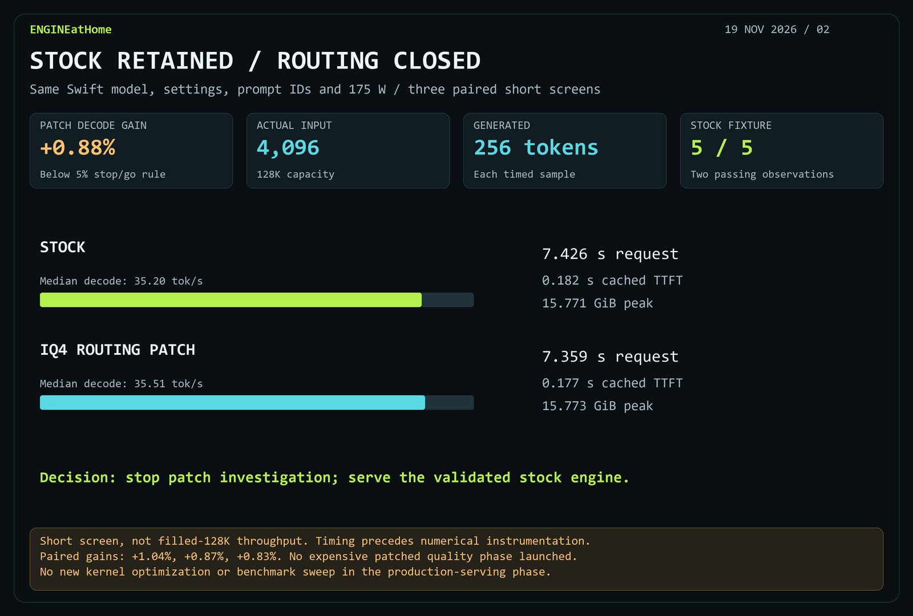](docs/swift-final-routing-2080ti-20261119.md)

[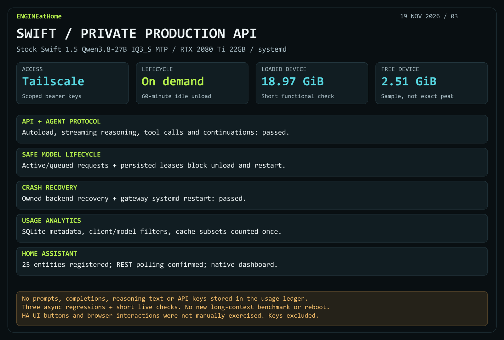](docs/production-serving.md)

[Latest recommendation and evidence](docs/swift-selected-20261119.md) · [Production setup and clients](docs/production-serving.md) · [Latest measurements JSON](docs/results/swift-serving-20261119.json) · [Serving source](serving/)

**Current selection: 19 November 2026.** Stock Swift 1.5 is our production winner. Its four-attempt coding set scored **4/4** on RTX 5070 Ti and **3/4** on RTX 2080 Ti. Guided Strata Coder retains the broader **18/18** six-issue result; Swift has not completed an equivalent 18-attempt matrix. The earlier Qwen3.6 Sphinx #10449 result remains a distinct hardest-task observation. Hardware, runtimes and harness details are linked beside each card.

RTX 2080 Ti benchmark cards

[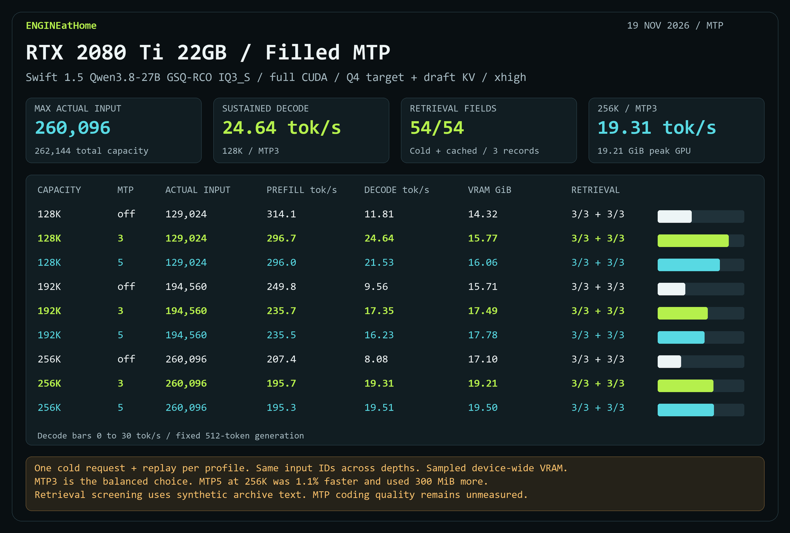](docs/swift-2080ti-20261119.md)

[RTX 2080 Ti report and all measurements](docs/swift-2080ti-20261119.md) · [Coding comparison card](docs/assets/swift-2080ti-coding.png) · [Raw evidence](bench/swift/evidence-manifest.json)

[Swift inference card](docs/assets/swift-qwen-inference.png) · [Benchmark report](docs/swift-qwen-20261118.md) · [Measurements JSON](docs/results/swift-qwen-20261118.json)

<b>Qwen3.8-27B-OBLITERATED Q4_K_M and RAM prompt cache</b> · 37.8 tok/s at 64K · cached follow-up 0.51 s

[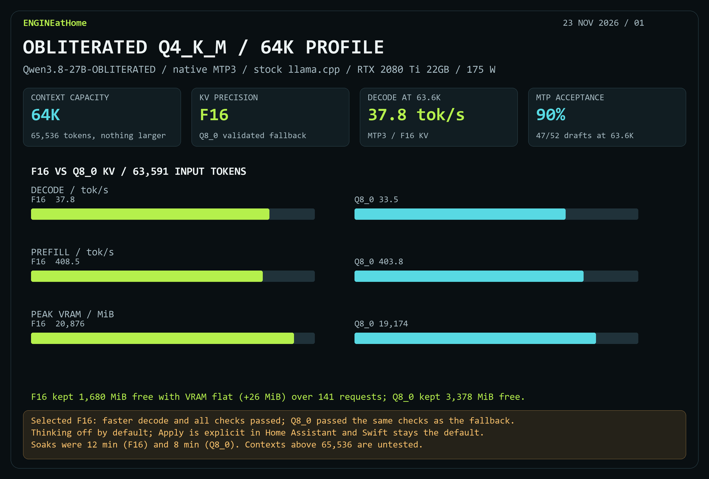](docs/obliterated-profile-and-ram-cache.md)

[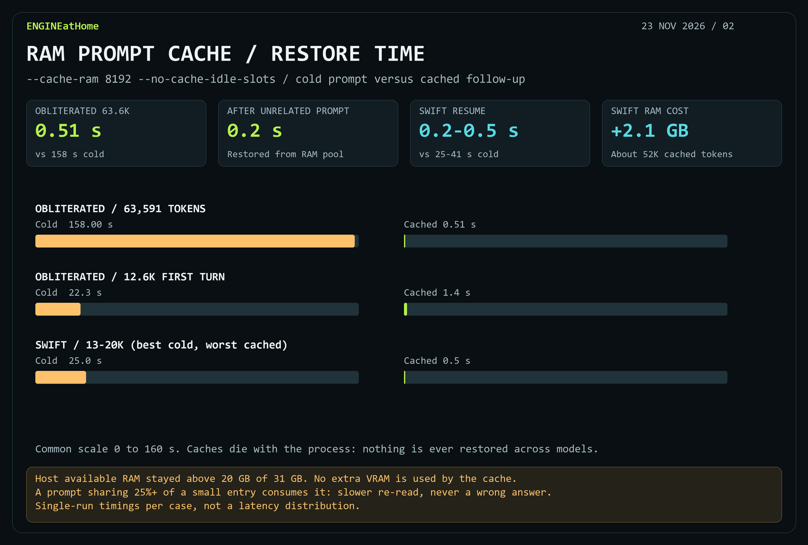](docs/obliterated-profile-and-ram-cache.md)

[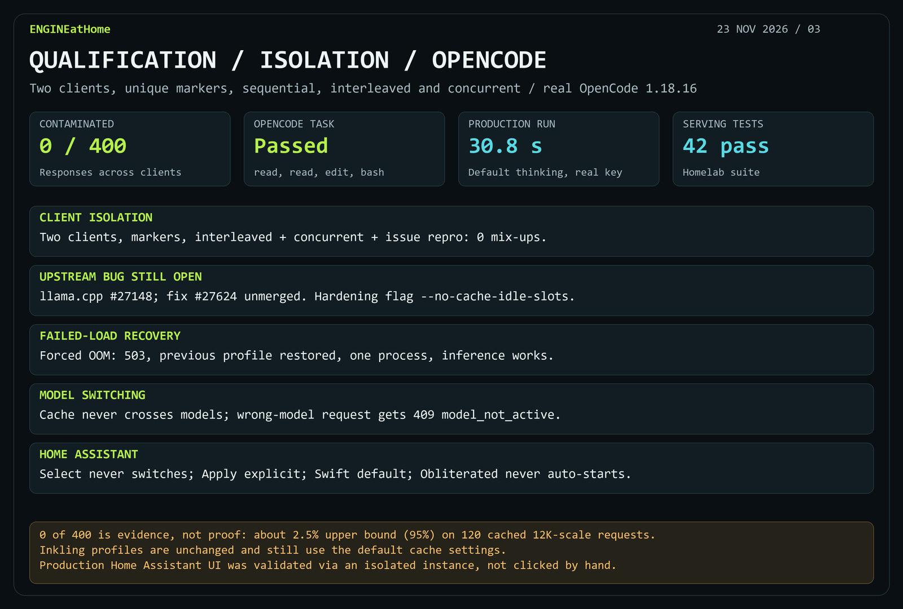](docs/obliterated-profile-and-ram-cache.md)

Selectable in Home Assistant (select never switches, Apply is explicit); Swift remains the default and Obliterated never auto-starts. 65,536 context only, F16 KV, Q8_0 validated fallback. Swift now runs `--cache-ram 8192 --no-cache-idle-slots`. The upstream isolation bug (llama.cpp #27148) is unfixed: 0 of 400 is evidence, not proof, and the Inkling profiles are unchanged.

[Report](docs/obliterated-profile-and-ram-cache.md) · [Measurements JSON](docs/results/obliterated-20261123.json) · [Research evidence](research/obliterated-q4km-2080ti/README.md)

<b>Inkling-Turing: long-context CUDA engineering (research engine)</b> · 242,134 actual input · 7/7 hidden tests · 3/3 checks

Inkling 2 Mini (UD-IQ3_XXS) on the RTX 2080 Ti 22 GB at 175 W, Q8_0 KV, with a llama.cpp fork carrying sm_75 kernels and a GPU-side relative-position path. Validated runtime `7d3e5b1`; fallbacks `e4a7ea6` and `e0be55a`. Swift 1.5 remains the selected production backend.

### Long-context qualification (runtime 7d3e5b1, Q8_0 KV)

| Run | Capacity | ubatch | Actual input (snapshot) | Context after session | Cold prefill | Prefill tok/s | Decode tok/s | Peak VRAM | Hidden tests | Follow-ups |
|---|---|---|---|---|---|---|---|---|---|---|
| 128K | 204,800 | 512 | 127,671 | 132,416 | 167.9 s | 766.7 | 35.8 | 20,570 MiB | 7/7 | 3/3 |
| 185K | 204,800 | 512 | 185,099 | 189,949 | 285.7 s | 652.5 | 30.5 | 20,572 MiB | 7/7 | 3/3 |
| 128K | 262,144 | 256 | 126,908 | 131,783 | 220.3 s | 583.7 | 36.3 | 19,852 MiB | 7/7 | 3/3 |
| **242K** | 262,144 | 256 | **242,134** | 246,714 | **556.1 s** | 437.3 | 26.8 | **19,846 MiB** | 7/7 | 3/3 |

| Cache behaviour at 242K | Value |
|---|---|
| Cold prefill (empty cache) | 556.1 s (9.3 min) |
| Cached follow-up TTFT | 1.24 to 1.34 s |
| Warm TTFT during the fix turn (median) | 2.49 s |
| Prefix reuse | 246,015 of 246,069 tokens |
| Scheduler re-plans | 0 |

| Memory engineering | Before (e4a7ea6) | After (7d3e5b1) |
|---|---|---|
| Host upload per 32K prefill | 2,333 MB | 13.2 MB |
| CPU fill per 32K prefill | 1,288.5 ms | 2.0 ms |
| Loaded VRAM, 256K at ub256 | 20,080 MiB | 19,824 MiB |

**Measured limits.** Largest qualified actual input is **242,134 snapshot tokens** (246,714 in context after the session) in a 262,144-token window at ub256; it is **not** a 256K actual-input run. ub512 does not load at 262,144.

**Limitations.** One successful run per context size, so this is a qualification and not a reliability estimate; a controlled synthetic-repository task, not SWE-bench; cold prefill at 242K takes 9.3 minutes, so interactive use needs a warm prefix cache; the ub512 and ub256 runs differ in capacity, seed and content.

**What was done.** The relative-position bias became one graph node and was then computed from cell and token positions on the GPU, removing the host uploads and making 256K fit at ub256 (the unfused build did not fit). A Flash Attention fusion of the bias was **rejected**: unit tests were bit-exact but model runs were unstable, and a graph audit shows prefill and decode op sequences diverge. Patches, the audit and the regression gate are published.

All Inkling-Turing cards

[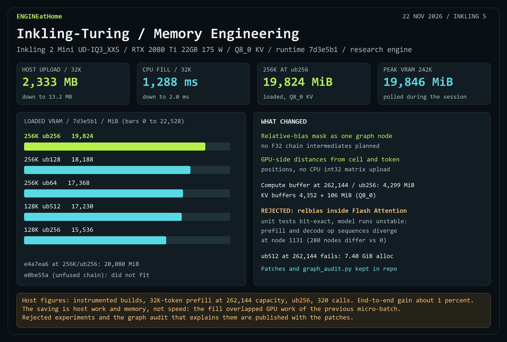](docs/inkling-turing-20261122.md#memory-engineering)

[Full report and methodology](docs/inkling-turing-20261122.md) · [Measurements JSON](docs/results/inkling-turing-20261122.json) · [Raw results and logs](research/inkling-turing/v06-longctx/results/) · [Long-context readiness report](research/inkling-turing/v06-longctx/LONGCTX_READINESS.md) · [Research bundle, patches and rebuild](research/inkling-turing/README.md) · [Rejected experiments](research/inkling-turing/rejected/) · [Graph audit](research/inkling-turing/v06-longctx/graph_audit.py)

<b>SenseNova-Loop-9B Q4_K_M</b> · 256K retrieval 6/6 · multi-hop 1/4 content, 0/4 strict JSON

| Check | Result |
|---|---|
| 256K retrieval | 6/6 |
| Multi-hop reasoning, content | 1/4 |
| Multi-hop reasoning, strict JSON | 0/4 |

[SenseNova-Loop-9B Q4_K_M report](docs/sensenova-loop-9b.md) · [Quality card](docs/assets/sensenova-phase2-quality.png) · [Timing card](docs/assets/sensenova-phase2-timing.png)

<b>Qwen3.8-Flash-Next GSQ-RCO IQ3_S on Strata 0.1.60</b> · 4K prefill chunks give 2.33x the throughput of 1K chunks at 128K

[Prefill report](docs/strata-iq3s-128k-prefill-20261117.md)

<b>Bonsai DSH 256K</b> · coding quality and runtime across seven 18-attempt configurations

[Bonsai DSH 256K report](docs/bonsai-dsh-256k-20261117.md) · [All 18 attempt times](docs/assets/bonsai-dsh-attempts.png) · [Bonsai vs. Ornith context plots](docs/assets/bonsai-ornith-context.png) · [Measurements JSON](docs/results/bonsai-dsh-256k-20261117.json)

<b>Qwen3.6 hardest task</b> · result at 64K, 92K and 128K capacity

[Qwen3.6 hardest-task and context-allocation report](docs/qwen36-hardest-context-20261114.md) · [Measurements JSON](docs/results/qwen36-hardest-context-20261114.json)

<b>Dense Qwen3.8-27B IQ3_S, DFlash2 and matched coding</b> · up to 84.8 tok/s at filled 64K · DFlash2 depth 7 above 100 tok/s

Matched coding ranking and supervision pilot

[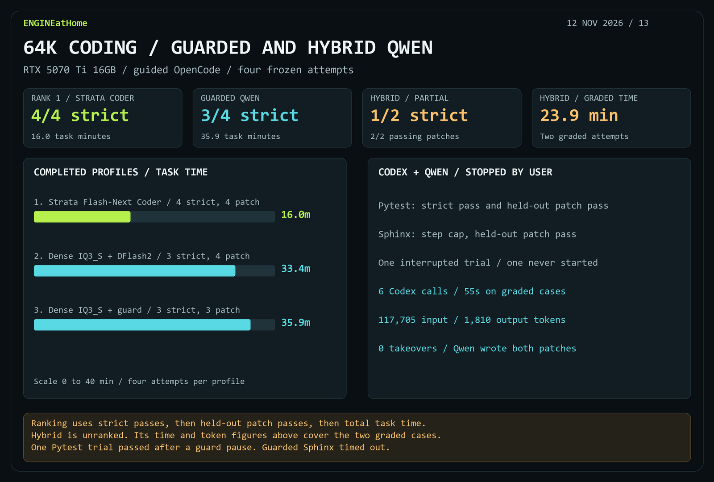](docs/dense-iq3s-supervision-20261112.md)

[Matched coding ranking and supervision pilot](docs/dense-iq3s-supervision-20261112.md) · [Measurements JSON](docs/results/dense-iq3s-supervision-20261112.json)

Live coding and retrieval (Dense DFlash2 vs Strata Coder)

[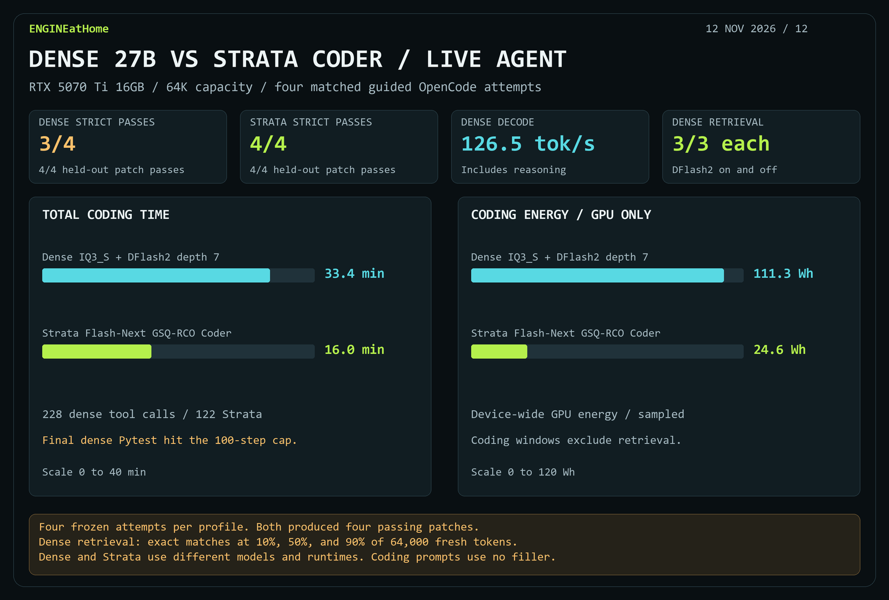](docs/dense-iq3s-live-20261112.md)

[Live coding and retrieval report](docs/dense-iq3s-live-20261112.md) · [Measurements JSON](docs/results/dense-iq3s-live-20261112.json)

DFlash2 depth sweep and OpenCode replay

[DFlash2 sweep and replay report](docs/dense-iq3s-dflash2-20261112.md) · [Measurements JSON](docs/results/dense-iq3s-dflash2-20261112.json)

Dense IQ3_S speed and context fit

[Dense IQ3_S speed report](docs/dense-iq3s-20261112.md) · [Measurements JSON](docs/results/dense-iq3s-20261112.json)

<b>Strata Coder</b> · guided 18/18 · 128K capacity six strict passes · one-hour 64K stability gate passed

128K capacity: six strict passes, 55,948 maximum actual input

[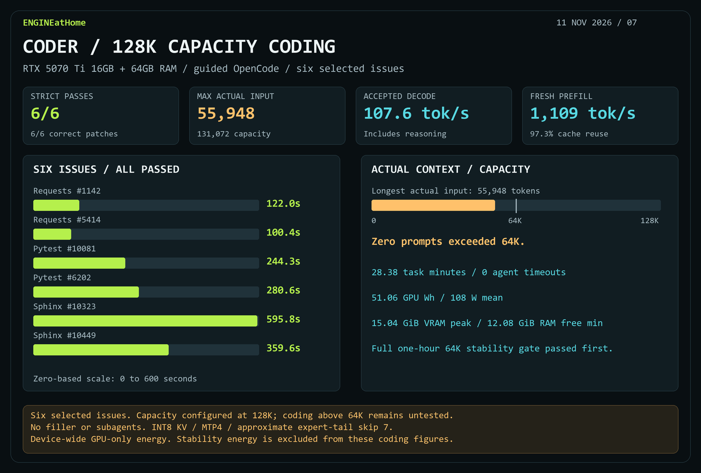](docs/strata-coder-agent128-20261111.md)

[128K-capacity coding report](docs/strata-coder-agent128-20261111.md) · [Measurements JSON](docs/results/strata-coder-agent128-20261111.json)

One-hour 64K stability gate

[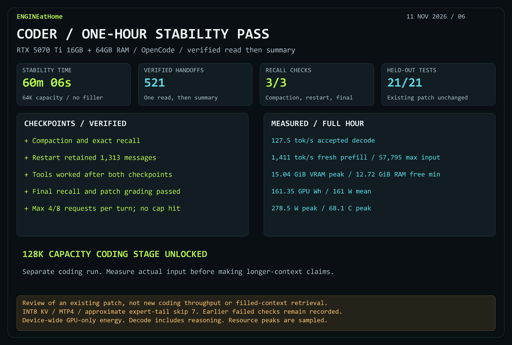](docs/strata-coder-stability-handoff-20261111.md)

[Stability report](docs/strata-coder-stability-handoff-20261111.md) · [Measurements JSON](docs/results/strata-coder-stability-handoff-20261111.json)

Guided Coder 18/18, faster matched tasks, restart recall failed

[Coding report](docs/strata-coder-guided18-20261111.md) · [Stability verdict](docs/strata-coder-workflow-verdict-20261111.md) · [Rankings & measurements](docs/results/strata-coder-workflow-20261111.json)

Filled-64K benchmark

[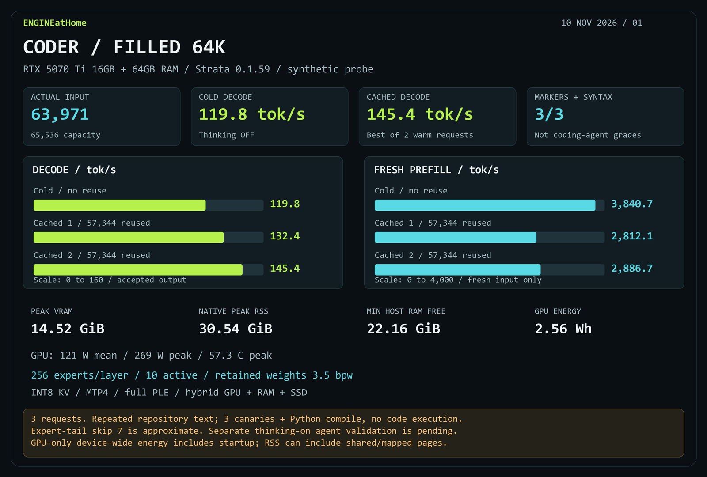](docs/strata-coder-filled64k-20261110.md)

[Full report](docs/strata-coder-filled64k-20261110.md) · [Measurements JSON](docs/results/strata-coder-filled64k-20261110.json)

Near-filled 128K and 256K

[Full report](docs/strata-coder-long-context-20261110.md) · [Measurements JSON](docs/results/strata-coder-long-context-20261110.json)

Coding-agent quality across Hermes and OpenCode

[OpenCode report](docs/strata-iq3-opencode18-20261110.md) · [Hermes report](docs/strata-iq3-thinking18-20261110.md) · [Measurements JSON](docs/results/strata-iq3-opencode18-20261110.json)

Corrected stability validation and expert-tail skipping

[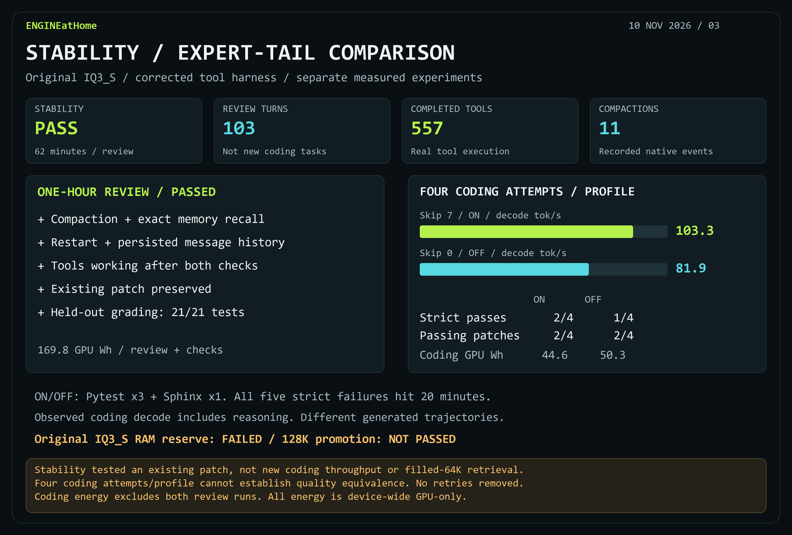](docs/strata-iq3-efficiency-20261110.md)

[Full report](docs/strata-iq3-efficiency-20261110.md) · [Measurements JSON](docs/results/strata-iq3-efficiency-20261110.json)

<b>Earlier experiments</b>

[Huihui 64K](docs/huihui-64k.md) · [DSpine 8K](docs/dspine-results.md) · [Thinking-budget pilot](docs/strata-iq3-opencode-hard-20261110.md) · [Model comparison](docs/model-comparison.md)

[Ornith 9B experimental speed tests](docs/ornith-9b-testing-20261113.md) · DFlash, EAGLE-3 and parallel batching

[Edge0-145B Q3_K at 16K](docs/edge0-145b-16k-quality-20261114.md) · fast inference, 0/18 strict coding passes and 2/18 held-out patch passes

<b>Setup, methodology and reproduction</b>

[Setup & methodology](docs/benchmark-guide.md) · [Architecture](docs/architecture-audit.md) · [Memory model](docs/memory-model.md)

[Commands & methodology](docs/benchmark-guide.md) · [Evidence manifest](bench/evidence/publication.json) · [Card renderer](bench/render_cards.py)

Model weights, binaries, credentials and raw local traces are excluded from Git. Detailed results and limitations stay linked beside each card.

