# ENGINEatHome

**RTX 5070 Ti 16GB · 64GB DDR5 · Current focus: 64K**

Building a specialized local inference engine. Current measurements use Strata and llama.cpp; the independent transformer graph and CUDA kernels are not implemented yet.

[Setup & methodology](docs/benchmark-guide.md) · [Architecture](docs/architecture-audit.md) · [Memory model](docs/memory-model.md)

[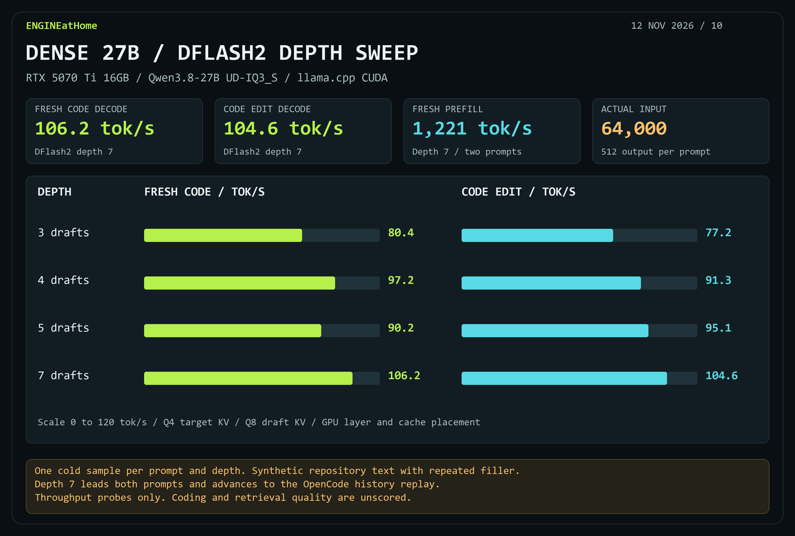](docs/dense-iq3s-dflash2-20261112.md)

[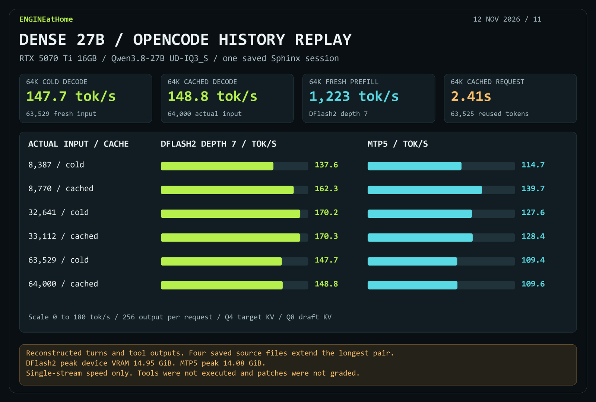](docs/dense-iq3s-dflash2-20261112.md#opencode-history-replay)

[DFlash2 sweep and replay report](docs/dense-iq3s-dflash2-20261112.md) · [Measurements JSON](docs/results/dense-iq3s-dflash2-20261112.json)

[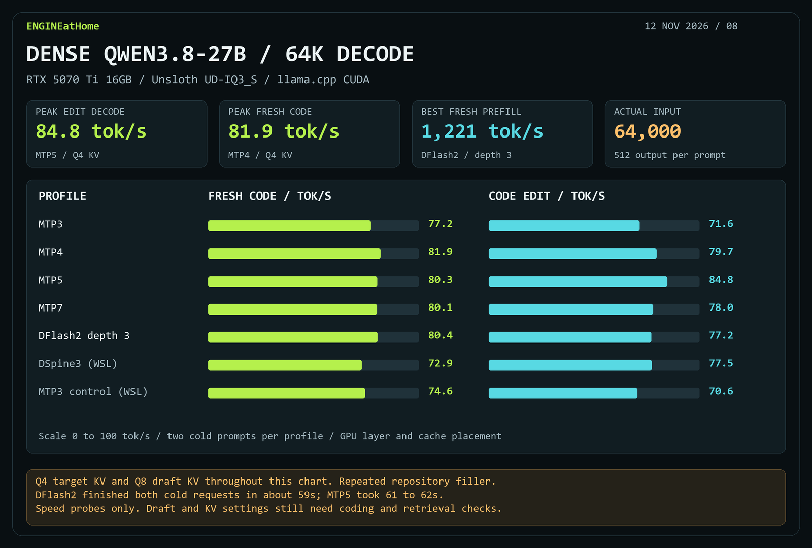](docs/dense-iq3s-20261112.md)

[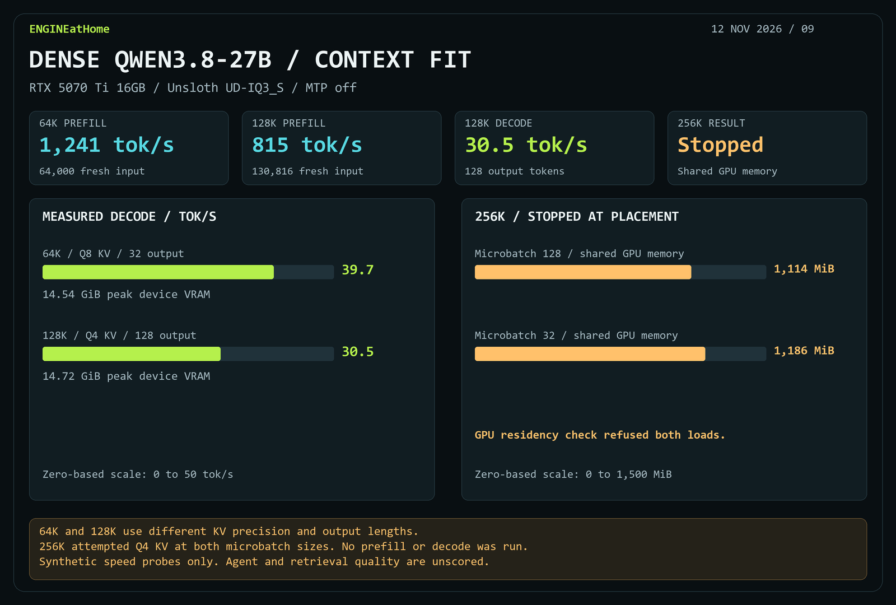](docs/dense-iq3s-20261112.md#context-fit-with-mtp-off)

[Dense IQ3_S speed report](docs/dense-iq3s-20261112.md) · [Measurements JSON](docs/results/dense-iq3s-20261112.json)

[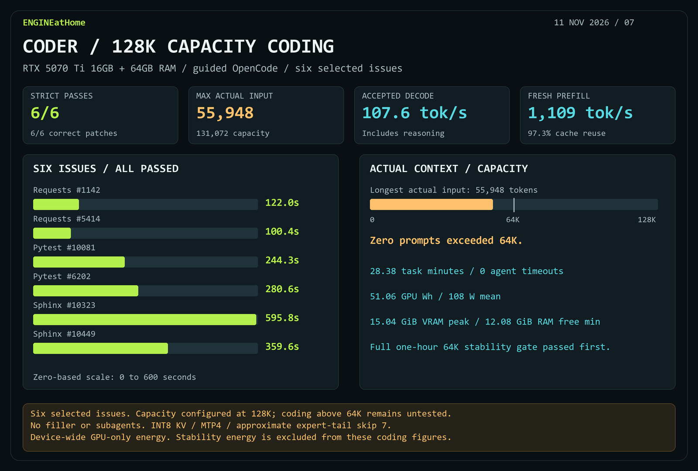](docs/strata-coder-agent128-20261111.md)

[128K-capacity coding report](docs/strata-coder-agent128-20261111.md) · [Measurements JSON](docs/results/strata-coder-agent128-20261111.json)

[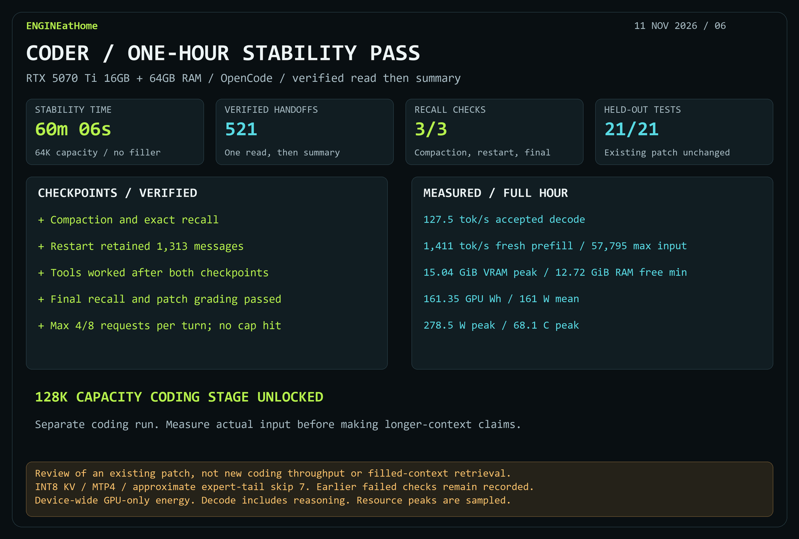](docs/strata-coder-stability-handoff-20261111.md)

[Stability report](docs/strata-coder-stability-handoff-20261111.md) · [Measurements JSON](docs/results/strata-coder-stability-handoff-20261111.json)

[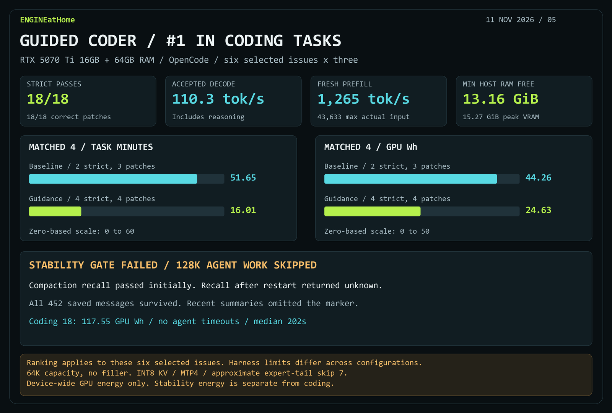](docs/strata-coder-guided18-20261111.md)

[Coding report](docs/strata-coder-guided18-20261111.md) · [Stability verdict](docs/strata-coder-workflow-verdict-20261111.md) · [Rankings & measurements](docs/results/strata-coder-workflow-20261111.json)

[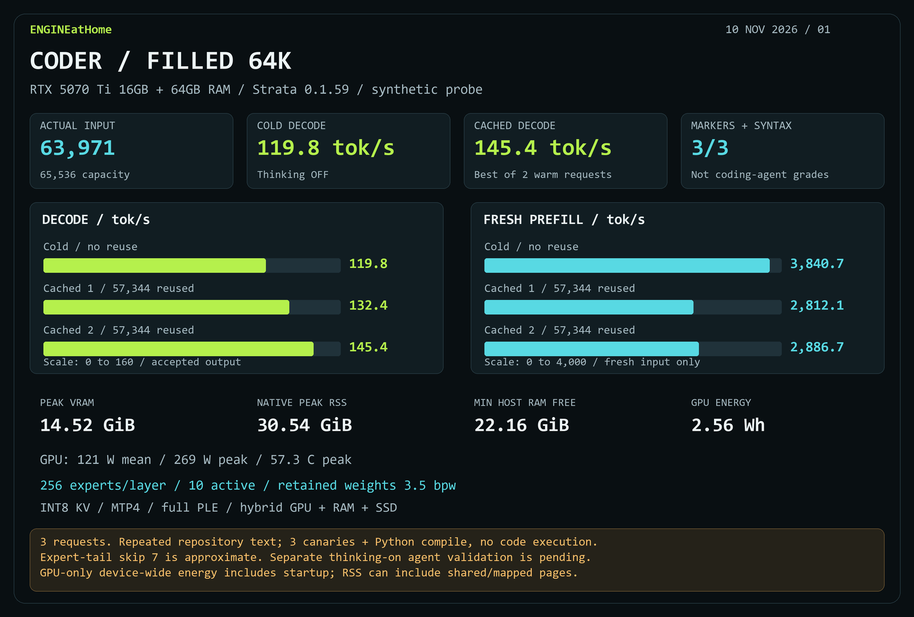](docs/strata-coder-filled64k-20261110.md)

[Full report](docs/strata-coder-filled64k-20261110.md) · [Measurements JSON](docs/results/strata-coder-filled64k-20261110.json)

[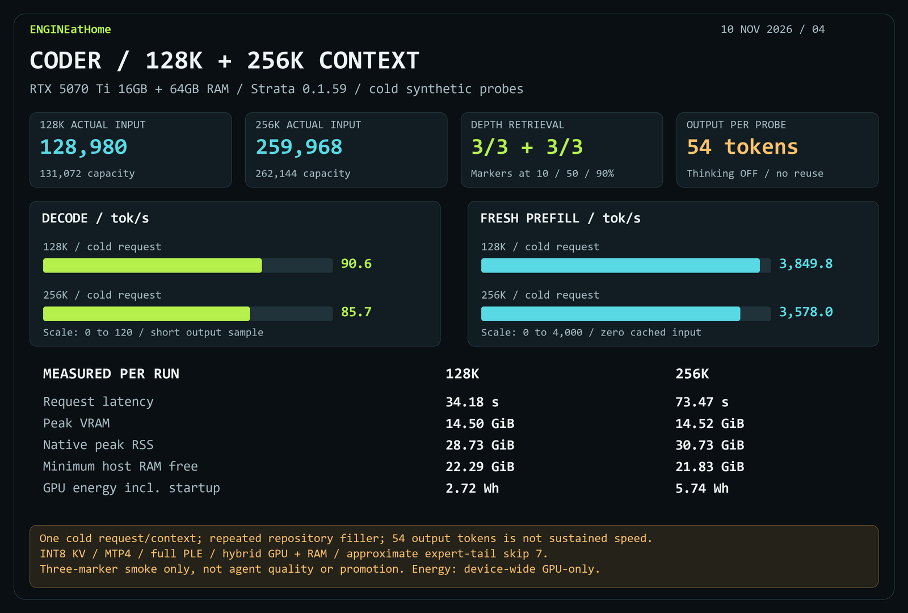](docs/strata-coder-long-context-20261110.md)

[Full report](docs/strata-coder-long-context-20261110.md) · [Measurements JSON](docs/results/strata-coder-long-context-20261110.json)

[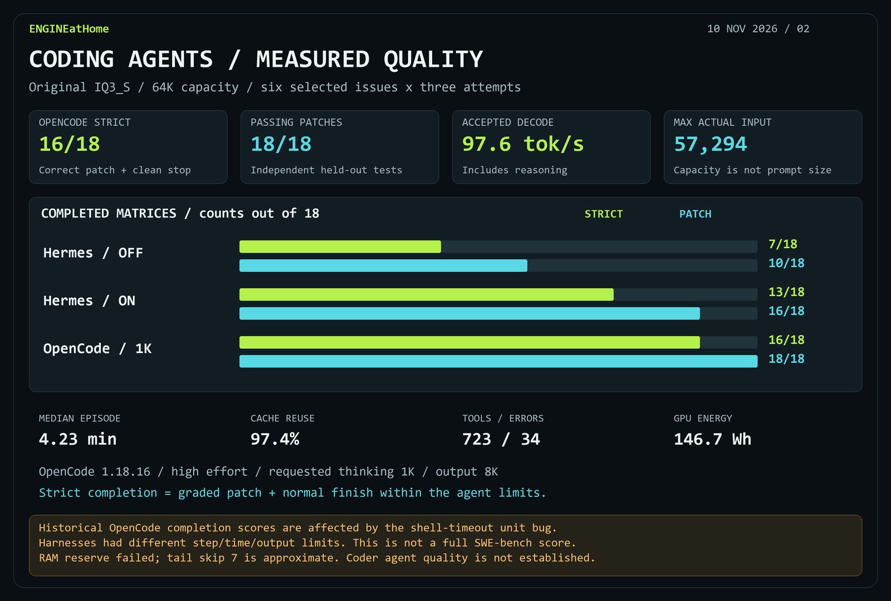](docs/strata-iq3-opencode18-20261110.md)

[OpenCode report](docs/strata-iq3-opencode18-20261110.md) · [Hermes report](docs/strata-iq3-thinking18-20261110.md) · [Measurements JSON](docs/results/strata-iq3-opencode18-20261110.json)

[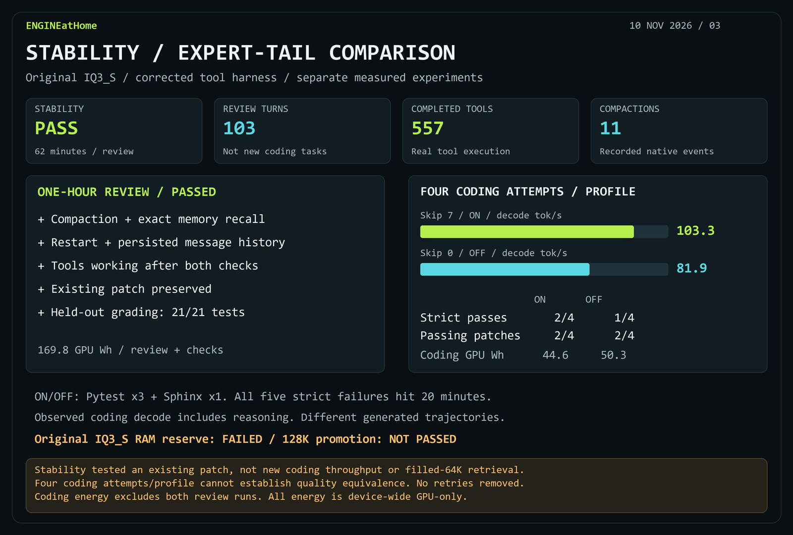](docs/strata-iq3-efficiency-20261110.md)

[Full report](docs/strata-iq3-efficiency-20261110.md) · [Measurements JSON](docs/results/strata-iq3-efficiency-20261110.json)

**Snapshot: 11 November 2026.** Guided Coder + OpenCode ranks first for observed strict completion on the six selected 64K coding issues (18/18), followed by original IQ3_S + OpenCode (16/18), Hermes with thinking (13/18) and Hermes without thinking (7/18). Model packages and harness limits differ. The later two-turn review passed the full 64K stability gate. All six separate 128K-capacity coding attempts passed, with **55,948 maximum actual input tokens** and no requests above 64K. Reliability above 64K remains untested in agent work.

### Earlier experiments

[Huihui 64K](docs/huihui-64k.md) · [DSpine 8K](docs/dspine-results.md) · [Thinking-budget pilot](docs/strata-iq3-opencode-hard-20261110.md) · [Model comparison](docs/model-comparison.md)

### Reproduce and inspect

[Commands & methodology](docs/benchmark-guide.md) · [Evidence manifest](bench/evidence/publication.json) · [Card renderer](bench/render_cards.py)

Model weights, binaries, credentials and raw local traces are excluded from Git. Detailed results and limitations stay linked beside each card.
