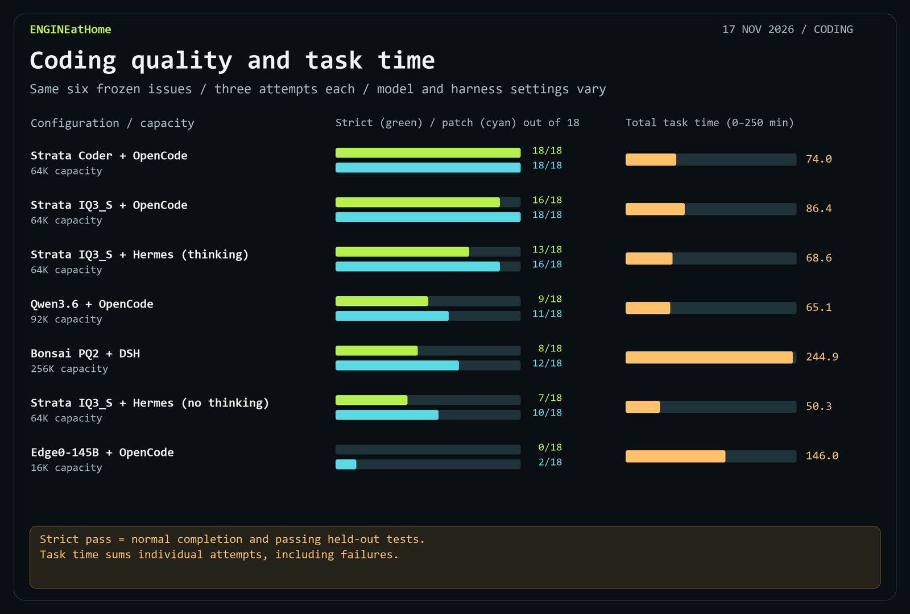
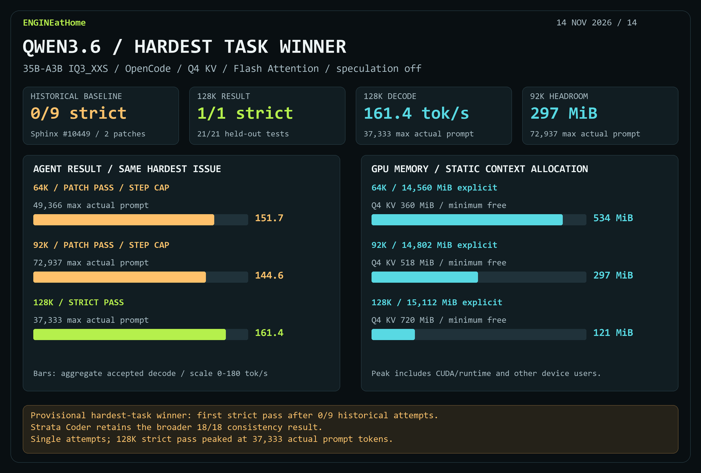
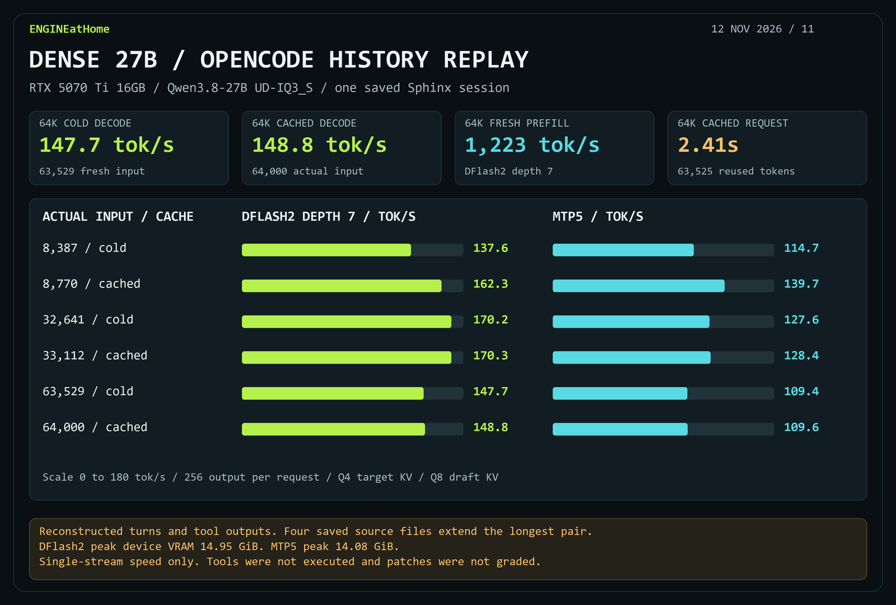
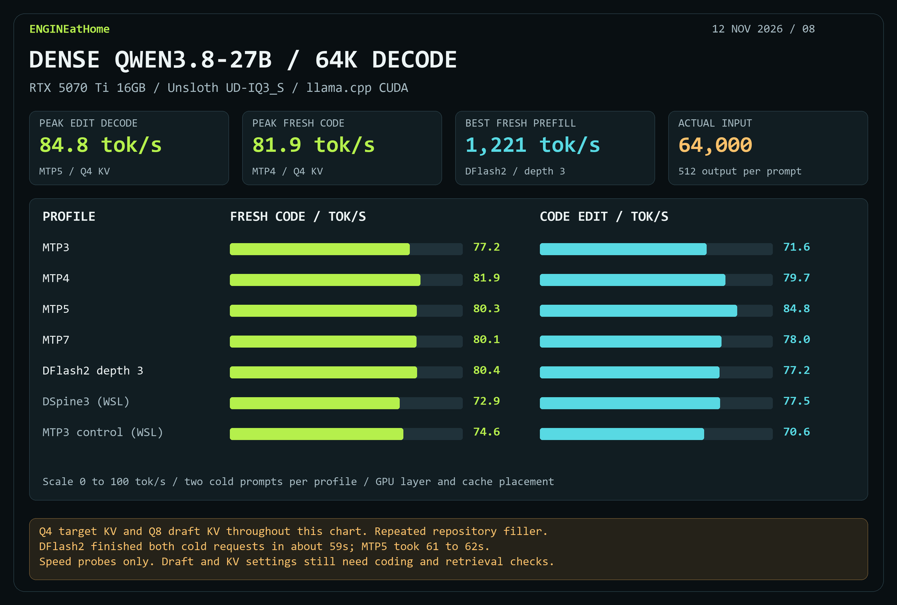
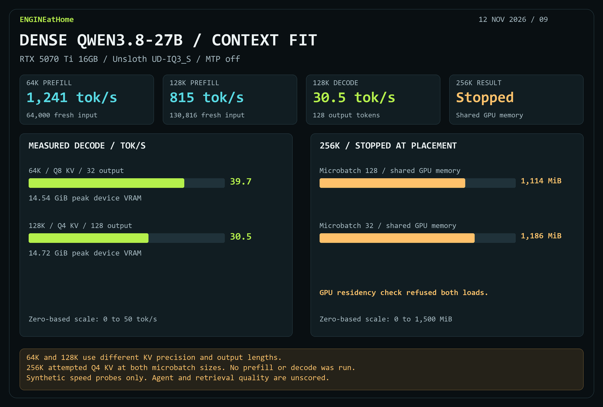
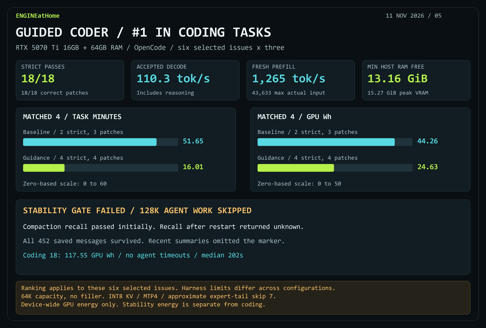

# ENGINEatHome

**RTX 5070 Ti 16GB · 64GB DDR5 · Current focus: 64K–128K coding agents**

Building a specialized local inference engine. Current measurements use Strata and llama.cpp; the independent transformer graph and CUDA kernels are not implemented yet.

[Setup & methodology](docs/benchmark-guide.md) · [Architecture](docs/architecture-audit.md) · [Memory model](docs/memory-model.md)

[Bonsai DSH 256K report](docs/bonsai-dsh-256k-20261117.md) · [All 18 attempt times](docs/assets/bonsai-dsh-attempts.png) · [Bonsai vs. Ornith context plots](docs/assets/bonsai-ornith-context.png) · [Measurements JSON](docs/results/bonsai-dsh-256k-20261117.json)

[Qwen3.6 hardest-task and context-allocation report](docs/qwen36-hardest-context-20261114.md) · [Measurements JSON](docs/results/qwen36-hardest-context-20261114.json)

[Matched coding ranking and supervision pilot](docs/dense-iq3s-supervision-20261112.md) · [Measurements JSON](docs/results/dense-iq3s-supervision-20261112.json)

[Live coding and retrieval report](docs/dense-iq3s-live-20261112.md) · [Measurements JSON](docs/results/dense-iq3s-live-20261112.json)

[DFlash2 sweep and replay report](docs/dense-iq3s-dflash2-20261112.md) · [Measurements JSON](docs/results/dense-iq3s-dflash2-20261112.json)

[Dense IQ3_S speed report](docs/dense-iq3s-20261112.md) · [Measurements JSON](docs/results/dense-iq3s-20261112.json)

[128K-capacity coding report](docs/strata-coder-agent128-20261111.md) · [Measurements JSON](docs/results/strata-coder-agent128-20261111.json)

[Stability report](docs/strata-coder-stability-handoff-20261111.md) · [Measurements JSON](docs/results/strata-coder-stability-handoff-20261111.json)

[Coding report](docs/strata-coder-guided18-20261111.md) · [Stability verdict](docs/strata-coder-workflow-verdict-20261111.md) · [Rankings & measurements](docs/results/strata-coder-workflow-20261111.json)

[Full report](docs/strata-coder-filled64k-20261110.md) · [Measurements JSON](docs/results/strata-coder-filled64k-20261110.json)

[Full report](docs/strata-coder-long-context-20261110.md) · [Measurements JSON](docs/results/strata-coder-long-context-20261110.json)

[OpenCode report](docs/strata-iq3-opencode18-20261110.md) · [Hermes report](docs/strata-iq3-thinking18-20261110.md) · [Measurements JSON](docs/results/strata-iq3-opencode18-20261110.json)

[Full report](docs/strata-iq3-efficiency-20261110.md) · [Measurements JSON](docs/results/strata-iq3-efficiency-20261110.json)

**Snapshot: 14 November 2026.** Qwen3.6-35B-A3B IQ3_XXS is the provisional hardest-task winner: it delivered the first strict pass on Sphinx #10449 after 0/9 strict passes in saved history, at **161.4 tok/s decode** with 128K capacity. Its separate 92K run reached **72,937 actual prompt tokens** and produced a passing patch, but hit the 100-call completion ceiling. Guided Strata Coder remains the broader consistency leader at 18/18 strict passes on the selected six-issue matrix. Model packages, task samples and runtimes differ.

### Earlier experiments

[Huihui 64K](docs/huihui-64k.md) · [DSpine 8K](docs/dspine-results.md) · [Thinking-budget pilot](docs/strata-iq3-opencode-hard-20261110.md) · [Model comparison](docs/model-comparison.md)

[Ornith 9B experimental speed tests](docs/ornith-9b-testing-20261113.md) · DFlash, EAGLE-3 and parallel batching

[Edge0-145B Q3_K at 16K](docs/edge0-145b-16k-quality-20261114.md) · fast inference, 0/18 strict coding passes and 2/18 held-out patch passes

### Reproduce and inspect

[Commands & methodology](docs/benchmark-guide.md) · [Evidence manifest](bench/evidence/publication.json) · [Card renderer](bench/render_cards.py)

Model weights, binaries, credentials and raw local traces are excluded from Git. Detailed results and limitations stay linked beside each card.
