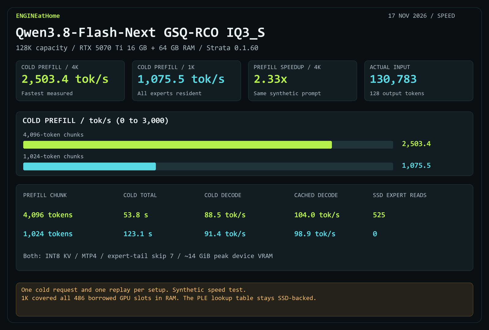
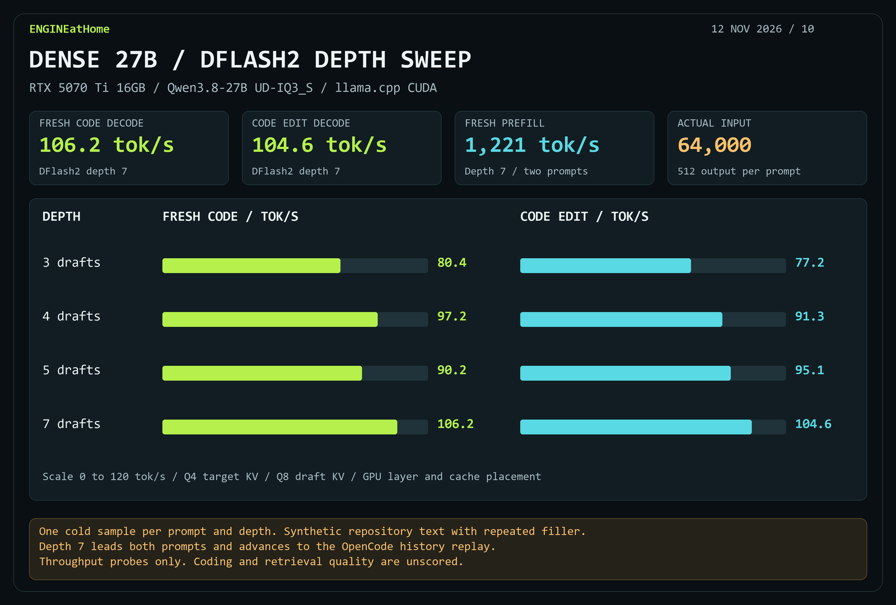
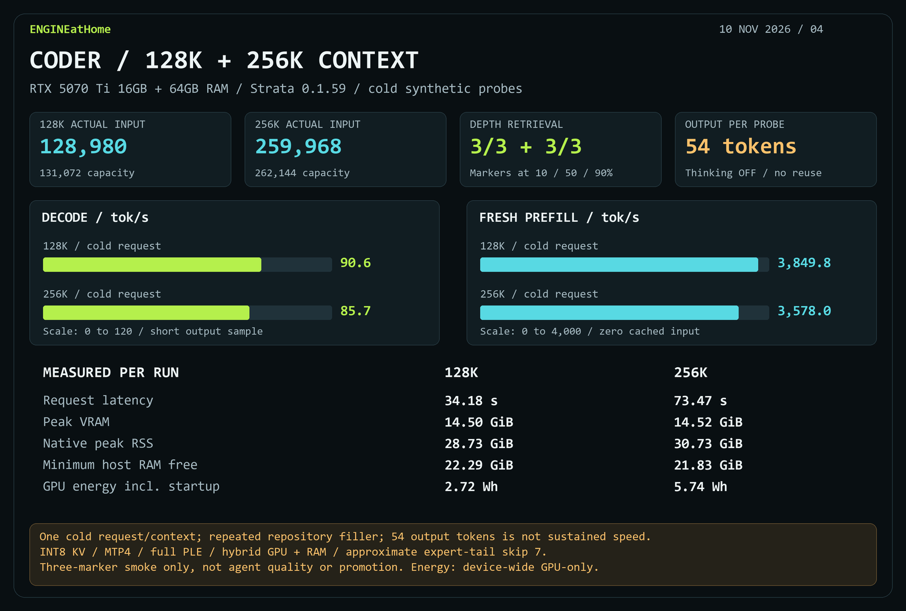
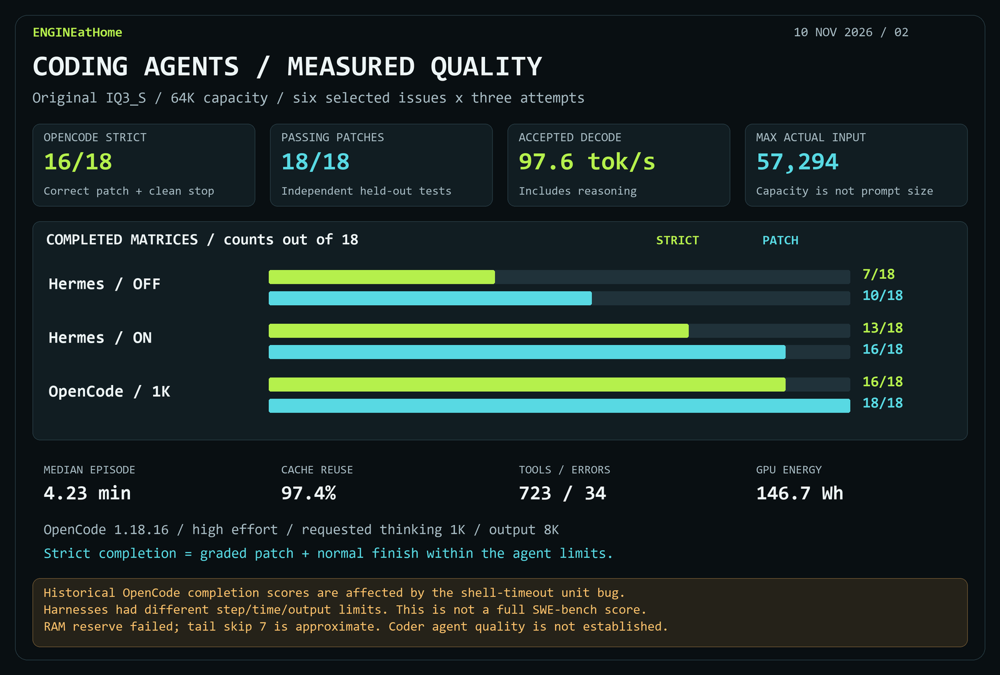

# ENGINEatHome

**RTX 5070 Ti 16GB + 64GB RAM · RTX 2080 Ti 22GB + 32GB RAM · Local coding-agent benchmarks**

Local inference benchmarking and private serving with Strata and llama.cpp. The independent transformer graph and CUDA kernels remain future work.

**Current winner for our deployment: stock Swift 1.5 Qwen3.8-27B GSQ-RCO IQ3_S MTP.** Selected on RTX 2080 Ti 22GB with 256K context, Q4 KV, MTP3, Flash Attention, xhigh thinking and a 175 W limit. This is our serving recommendation; historical scores and failures remain unchanged.

[Latest recommendation and evidence](docs/swift-selected-20261119.md) · [Production setup and clients](docs/production-serving.md) · [Latest measurements JSON](docs/results/swift-serving-20261119.json) · [Serving source](serving/)

[Setup & methodology](docs/benchmark-guide.md) · [Architecture](docs/architecture-audit.md) · [Memory model](docs/memory-model.md)

[RTX 2080 Ti report and all measurements](docs/swift-2080ti-20261119.md) · [Coding comparison card](docs/assets/swift-2080ti-coding.png) · [Raw evidence](bench/swift/evidence-manifest.json)

[Swift inference card](docs/assets/swift-qwen-inference.png) · [Benchmark report](docs/swift-qwen-20261118.md) · [Measurements JSON](docs/results/swift-qwen-20261118.json)

[SenseNova-Loop-9B Q4_K_M](docs/sensenova-loop-9b.md) · 256K retrieval **6/6**, multi-hop reasoning **1/4 content** and **0/4 strict JSON** · [Quality card](docs/assets/sensenova-phase2-quality.png) · [Timing card](docs/assets/sensenova-phase2-timing.png)

[Bonsai DSH 256K report](docs/bonsai-dsh-256k-20261117.md) · [All 18 attempt times](docs/assets/bonsai-dsh-attempts.png) · [Bonsai vs. Ornith context plots](docs/assets/bonsai-ornith-context.png) · [Measurements JSON](docs/results/bonsai-dsh-256k-20261117.json)

[Qwen3.6 hardest-task and context-allocation report](docs/qwen36-hardest-context-20261114.md) · [Measurements JSON](docs/results/qwen36-hardest-context-20261114.json)

[Matched coding ranking and supervision pilot](docs/dense-iq3s-supervision-20261112.md) · [Measurements JSON](docs/results/dense-iq3s-supervision-20261112.json)

[Live coding and retrieval report](docs/dense-iq3s-live-20261112.md) · [Measurements JSON](docs/results/dense-iq3s-live-20261112.json)

[DFlash2 sweep and replay report](docs/dense-iq3s-dflash2-20261112.md) · [Measurements JSON](docs/results/dense-iq3s-dflash2-20261112.json)

[Dense IQ3_S speed report](docs/dense-iq3s-20261112.md) · [Measurements JSON](docs/results/dense-iq3s-20261112.json)

[128K-capacity coding report](docs/strata-coder-agent128-20261111.md) · [Measurements JSON](docs/results/strata-coder-agent128-20261111.json)

[Stability report](docs/strata-coder-stability-handoff-20261111.md) · [Measurements JSON](docs/results/strata-coder-stability-handoff-20261111.json)

[Coding report](docs/strata-coder-guided18-20261111.md) · [Stability verdict](docs/strata-coder-workflow-verdict-20261111.md) · [Rankings & measurements](docs/results/strata-coder-workflow-20261111.json)

[Full report](docs/strata-coder-filled64k-20261110.md) · [Measurements JSON](docs/results/strata-coder-filled64k-20261110.json)

[Full report](docs/strata-coder-long-context-20261110.md) · [Measurements JSON](docs/results/strata-coder-long-context-20261110.json)

[OpenCode report](docs/strata-iq3-opencode18-20261110.md) · [Hermes report](docs/strata-iq3-thinking18-20261110.md) · [Measurements JSON](docs/results/strata-iq3-opencode18-20261110.json)

[Full report](docs/strata-iq3-efficiency-20261110.md) · [Measurements JSON](docs/results/strata-iq3-efficiency-20261110.json)

**Current selection: 19 November 2026.** Stock Swift 1.5 is our production winner. Its four-attempt coding set scored **4/4** on RTX 5070 Ti and **3/4** on RTX 2080 Ti. Guided Strata Coder retains the broader **18/18** six-issue result; Swift has not completed an equivalent 18-attempt matrix. The earlier Qwen3.6 Sphinx #10449 result remains a distinct hardest-task observation. Hardware, runtimes and task coverage differ; this recommendation does not rewrite those measurements.

### Earlier experiments

[Huihui 64K](docs/huihui-64k.md) · [DSpine 8K](docs/dspine-results.md) · [Thinking-budget pilot](docs/strata-iq3-opencode-hard-20261110.md) · [Model comparison](docs/model-comparison.md)

[Ornith 9B experimental speed tests](docs/ornith-9b-testing-20261113.md) · DFlash, EAGLE-3 and parallel batching

[Edge0-145B Q3_K at 16K](docs/edge0-145b-16k-quality-20261114.md) · fast inference, 0/18 strict coding passes and 2/18 held-out patch passes

### Reproduce and inspect

[Commands & methodology](docs/benchmark-guide.md) · [Evidence manifest](bench/evidence/publication.json) · [Card renderer](bench/render_cards.py)

Model weights, binaries, credentials and raw local traces are excluded from Git. Detailed results and limitations stay linked beside each card.
