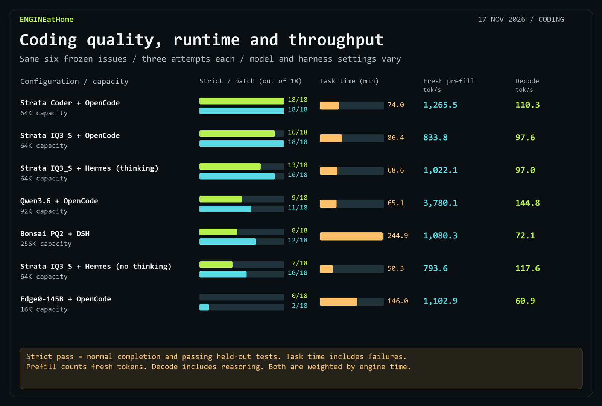
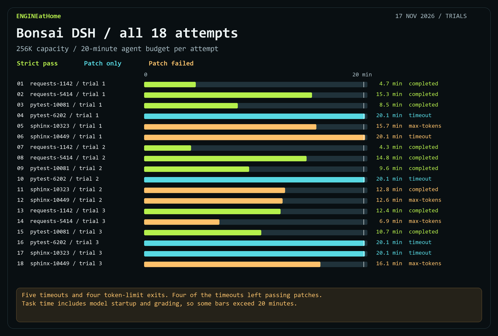
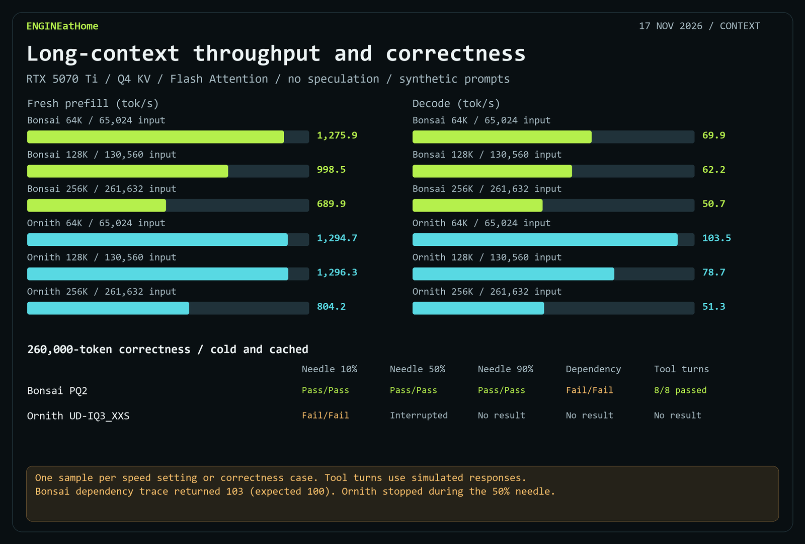

# Bonsai PQ2 with DeepSeek Harness at 256K

Bonsai finished **8 of 18 attempts with passing patches and normal agent completion**. The independent grader passed **12 of 18 patches**. Guided Strata Coder passed all 18 attempts and took 74.0 minutes of task time, versus 244.9 minutes for Bonsai. Each full matrix uses the same six frozen SWE-bench Verified issues with three attempts per issue. Models, harnesses, context capacities and completion limits vary.

| Configuration | Capacity | Strict | Patch | Task minutes | Median |
| --- | ---: | ---: | ---: | ---: | ---: |
| Strata Coder + OpenCode | 64K | 18/18 | 18/18 | 74.0 | 3m 22s |
| Strata IQ3_S + OpenCode | 64K | 16/18 | 18/18 | 86.4 | 4m 14s |
| Strata IQ3_S + Hermes, thinking on | 64K | 13/18 | 16/18 | 68.6 | 3m 16s |
| Qwen3.6 + OpenCode | 92K | 9/18 | 11/18 | 65.1 | 2m 53s |
| Bonsai PQ2 + DSH | 256K | 8/18 | 12/18 | 244.9 | 13m 49s |
| Strata IQ3_S + Hermes, thinking off | 64K | 7/18 | 10/18 | 50.3 | 2m 11s |
| Edge0-145B + OpenCode | 16K | 0/18 | 2/18 | 146.0 | 6m 23s |

Historical IQ3_S OpenCode completion was affected by shell-timeout units. Its patch grades remain valid. Task time sums individual attempts, including failed attempts. The Qwen3.6 92K full matrix is separate from the Sphinx #10449 reruns, which both went 3/3 strict and 3/3 patch, with median times of 5m 55s at 92K and 3m 56s at 128K.

## Bonsai attempt breakdown

| Issue | Strict | Patch |
| --- | ---: | ---: |
| Requests #1142 | 3/3 | 3/3 |
| Requests #5414 | 2/3 | 2/3 |
| Pytest #10081 | 3/3 | 3/3 |
| Pytest #6202 | 0/3 | 3/3 |
| Sphinx #10323 | 0/3 | 1/3 |
| Sphinx #10449 | 0/3 | 0/3 |

Nine attempts finished normally, including one failing patch. Five timed out and four ended at a token limit. Four timeouts left passing patches, including all three Pytest #6202 attempts. The separate 64K DSH pilot had one strict pass and two passing patches across two graded attempts. A third pilot attempt was interrupted before grading.

Bonsai ran with Prism llama.cpp b12128, Q4_0 key and value caches, Flash Attention, and speculation disabled. DSH used a fresh session per attempt with a 20-minute limit. The model loaded with all layers assigned to the GPU. The largest actual prompt was **167,615 tokens** out of 262,144 capacity. Bonsai campaign peak RAM, peak VRAM and energy are unavailable.

| Coding configuration | Decode, tok/s | Fresh prefill, tok/s | Largest prompt |
| --- | ---: | ---: | ---: |
| Bonsai PQ2 + DSH | 72.1 | 1,080 | 167,615 |
| Strata Coder + OpenCode | 110.3 | 1,265 | 43,633 |
| Strata IQ3_S + OpenCode | 97.6 | 834 | 57,294 |
| Strata IQ3_S + Hermes, thinking on | 97.0 | 1,022 | 49,964 |
| Strata IQ3_S + Hermes, thinking off | 117.6 | 794 | 34,165 |
| Qwen3.6 + OpenCode | 144.8 | 3,780 | 77,943 |
| Edge0-145B + OpenCode | 60.9 | 1,103 | 16,357 |

Bonsai rates divide the sum of logged tokens by the sum of engine processing time for each phase across 1,280 timed requests. Decode includes reasoning. Task time also includes tool execution, model startup, and grading.

Guided Strata Coder is the default for this coding workload on the strength of its 18/18 strict result. Qwen3.6 has the highest measured prefill and decode rates. Bonsai handled the largest actual prompt but took over three times longer than guided Strata Coder across the matrix.

## Synthetic context tests

The speed sweep used a single fresh prompt per setting and 256 output tokens. The separate correctness suite used 260,000 input tokens within 256K capacity. Bonsai passed all three needle depths cold and cached, then returned **103** on the multi-file dependency question in both modes. The expected answer was **100**. Its eight simulated tool-result continuations passed in **0.32–0.37 seconds each** after the prefix loaded.

Ornith failed the 10% needle cold and cached, repeating the instruction. Its 50% attempt was interrupted. At 10%, the two models received identical token IDs. Cold request time was **6m 20s** for Bonsai and **16m 7s** for Ornith. The cached repeats reused 259,996 of 260,000 tokens and took **0.54s** and **0.62s**, respectively.

[Measurements JSON](results/bonsai-dsh-256k-20261117.json) · [Strata Coder 18-attempt report](strata-coder-guided18-20261111.md) · [Earlier Qwen3.6 single-attempt context tests](qwen36-hardest-context-20261114.md)
