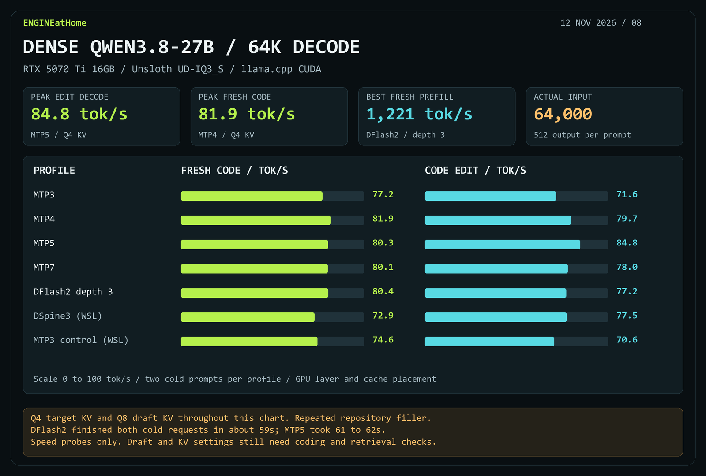
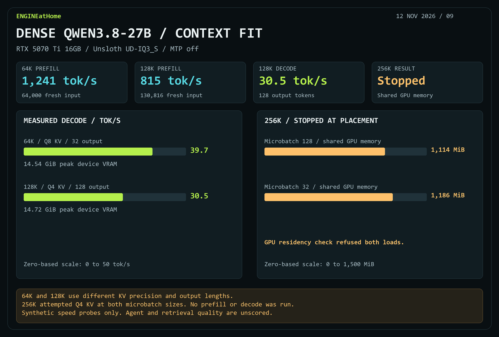

# Dense Qwen3.8-27B UD-IQ3_S speed on the RTX 5070 Ti

**MTP5 reached 84.8 tok/s on the edit prompt.** MTP4 reached 81.9 tok/s on fresh code. DFlash2 at depth 3 finished the two cold requests in 58.8 and 59.1 seconds, compared with 61.6 and 61.2 seconds for MTP5.

## Filled 64K

Each row has two synthetic prompts with 64,000 fresh input tokens and 512 forced output tokens per request. Target K/V is Q4_0 and draft K/V is Q8_0. All rates are tokens per second.

| Profile | Fresh code decode | Code edit decode | Mean fresh prefill | Peak device VRAM |
| --- | ---: | ---: | ---: | ---: |
| MTP3 | 77.24 | 71.57 | 1,160.9 | 13.61 GiB |
| MTP4 | 81.93 | 79.69 | 1,158.8 | 13.75 GiB |
| MTP5 | 80.29 | 84.77 | 1,159.4 | 13.89 GiB |
| MTP7 | 80.12 | 78.03 | 1,157.4 | 14.18 GiB |
| DFlash2 depth 3 | 80.43 | 77.22 | 1,221.2 | 14.18 GiB |
| DSpine3, WSL | 72.90 | 77.45 | 1,205.4 | 14.37 GiB |
| MTP3 control, same WSL build | 74.57 | 70.58 | 1,153.0 | 13.63 GiB |

The separate 256-output-token sweep measured **40.29 tok/s** for the Q8 control and **71.32 tok/s** for Q8 MTP3, with **176/236** drafts accepted. Mixed Q8 keys and Q4 values reached **73.18 tok/s** with MTP3. Q4 K/V MTP3 reached **73.34 tok/s** and used **1 GiB less sampled peak VRAM** than Q8 MTP3. N-gram drafting produced zero proposals on that fixture, and GPU sampling moved decode from 40.29 to 40.48 tok/s. All nine profiles are in the measurements.

## Context fit with MTP off

| Capacity | Actual fresh input | Output | K/V | Fresh prefill | Decode |
| --- | ---: | ---: | --- | ---: | ---: |
| 65,536 | 64,000 | 32 | Q8_0 | 1,241.4 | 39.69 |
| 131,072 | 130,816 | 128 | Q4_0 | 814.5 | 30.53 |
| 262,144 | — | — | Q4_0 | — | — |

The 128K probe took 160.66 seconds to the first token and peaked at 15,073 MiB of device VRAM. Both 256K loads reported GPU layer and cache placement, but Windows reported 1,114 MiB and 1,186 MiB of shared GPU memory at microbatches 128 and 32 respectively. The residency check stopped both before inference.

## Scope

- One sample per fixture and profile. Input contains repeated synthetic repository text. Coding, retrieval, and long-session quality remain unscored.
- The native Windows and WSL runs use different llama.cpp revisions. Use the WSL MTP3 row for the matched DSpine comparison.
- Placement logs verify GPU layers, KV, and recurrent state. llama.cpp retains its CPU-mapped input buffer. Windows placement was corroborated by process memory counters. WSL uses device-wide counters. Peak VRAM is sampled and includes other applications. Energy in the JSON is GPU device-wide only.
- [Exact IQ3_S model file](https://huggingface.co/unsloth/Qwen3.8-27B-GGUF/blob/main/Qwen3.8-27B-UD-IQ3_S.gguf) · [DFlash2 draft](https://huggingface.co/incoai/Qwen3.8-27B-DFlash2-GGUF/blob/main/Qwen3.8-27B-DFlash2-Q4_K_M.gguf) · [DSpine build and draft provenance](dspine-results.md)

[Measurements JSON](results/dense-iq3s-20261112.json)
