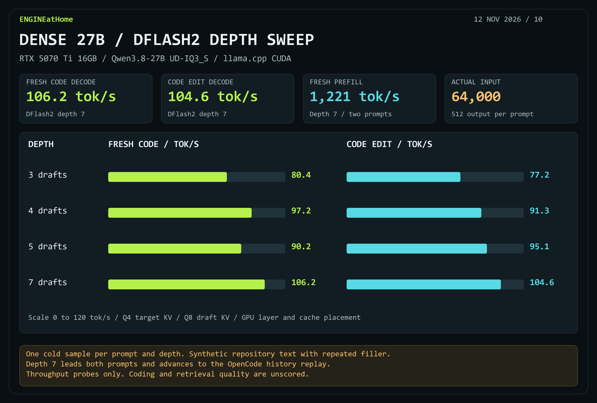
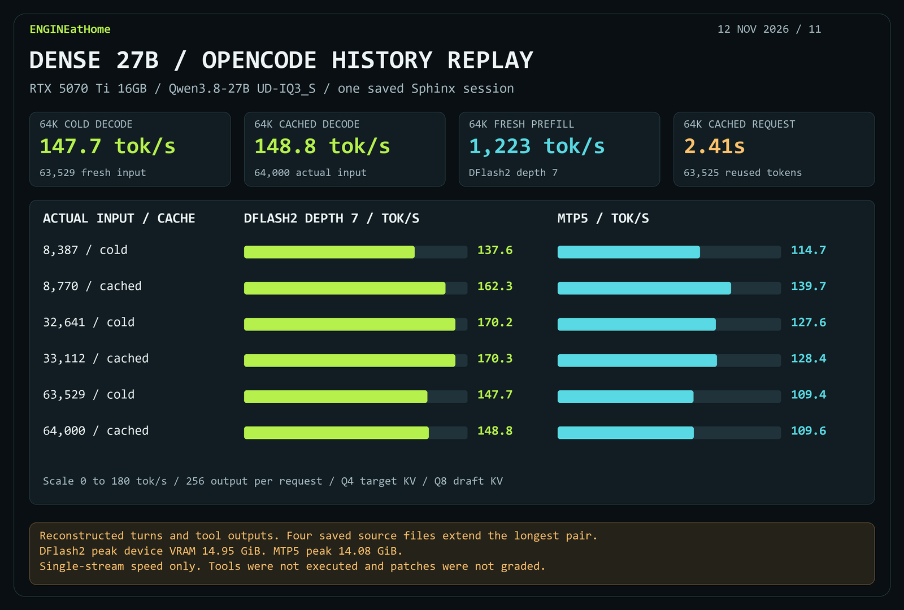

# DFlash2 depth 7 on dense Qwen3.8-27B UD-IQ3_S

Each depth ran two cold prompts with 64,000 fresh input tokens and 512 forced output tokens. The fixture repeats synthetic repository text. Rates are tokens per second.

| Draft depth | Fresh-code decode | Edit decode | Mean fresh prefill |
| --- | ---: | ---: | ---: |
| 3 | 80.4 | 77.2 | 1,221 |
| 4 | 97.2 | 91.3 | 1,224 |
| 5 | 90.2 | 95.1 | 1,222 |
| **7** | **106.2** | **104.6** | 1,221 |

## OpenCode history replay

Both profiles received the same inputs and generated 256 tokens per request. DFlash2 finished every request faster and used 14.95 GiB of sampled peak device VRAM. MTP5 used 14.08 GiB.

| Actual input | Reused | DFlash2 decode | MTP5 decode | DFlash2 total | MTP5 total |
| ---: | ---: | ---: | ---: | ---: | ---: |
| 8,387 | 0 | 137.6 | 114.7 | 6.43s | 7.16s |
| 8,770 | 8,383 | 162.3 | 139.7 | 1.89s | 2.15s |
| 32,641 | 0 | 170.2 | 127.6 | 22.63s | 24.13s |
| 33,112 | 32,637 | 170.3 | 128.4 | 2.03s | 2.52s |
| 63,529 | 0 | 147.7 | 109.4 | 53.68s | 57.04s |
| 64,000 | 63,525 | 148.8 | 109.6 | 2.41s | 3.05s |

At 63,529 fresh input tokens, DFlash2 reached 1,223.5 tok/s prefill and 51.95s time to first token. MTP5 reached 1,161.6 tok/s and 54.71s. The 64,000-token cached follow-up evaluated 475 fresh tokens, with 0.69s and 0.72s to first token respectively.

- The benchmark reconstructed messages and tool outputs from one saved Sphinx session using the model's chat template. Four saved source files were added to reach the longest context. Tool execution and patch grading were outside the replay.
- Both profiles used the same llama.cpp Windows CUDA build, 65,536-token capacity, Q4_0 target KV, Q8_0 draft KV, and one slot. GPU layer and cache placement were verified. Peak VRAM includes other applications, and JSON energy is sampled, device-wide GPU only.
- The [measurements JSON](results/dense-iq3s-dflash2-20261112.json) includes per-request prefill, decode, latency, draft acceptance and sampled energy. The [previous dense IQ3_S report](dense-iq3s-20261112.md) covers MTP depth, DSpine and 128K/256K fit.
