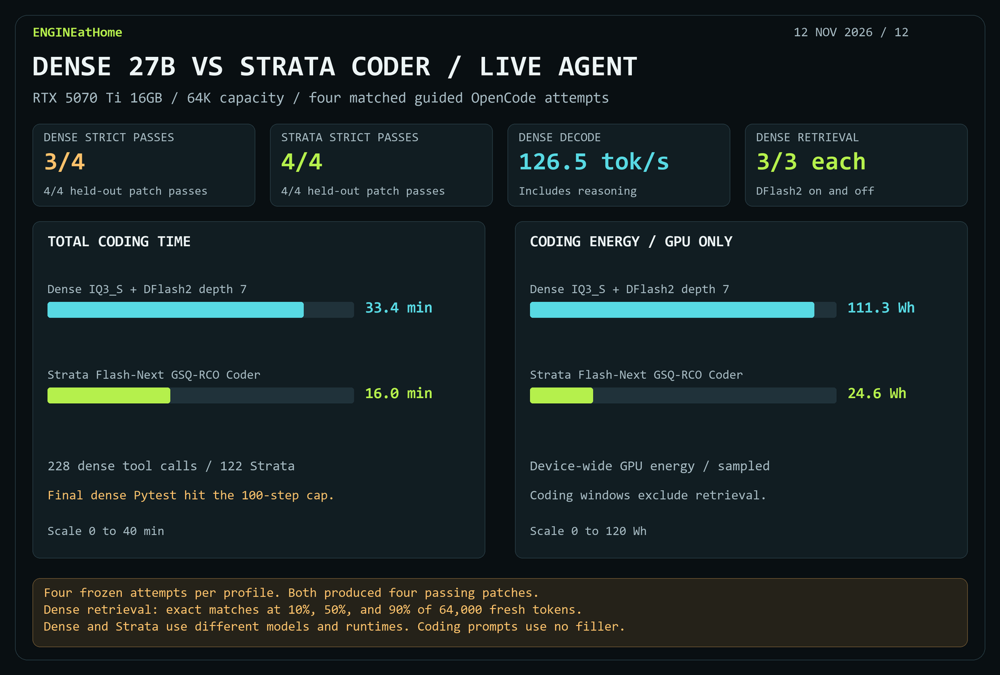

# Dense IQ3_S + DFlash2 versus Strata Coder in live OpenCode

Both configurations produced **four passing patches** on the same four frozen attempts. Strata Coder completed all four normally in **16m 01s**. Dense IQ3_S with DFlash2 depth 7 completed three normally and took **33m 26s** for the set.

| Metric | Dense IQ3_S + DFlash2 depth 7 | Strata Flash-Next GSQ-RCO Coder |
| --- | ---: | ---: |
| Strict completion | 3/4 | 4/4 |
| Held-out patch passes | 4/4 | 4/4 |
| Total task time | 33.43 min | 16.01 min |
| Accepted decode, including reasoning | 126.46 tok/s | 108.03 tok/s |
| Fresh prefill | 1,222.32 tok/s | 1,139.50 tok/s |
| Longest actual prompt | 57,092 | 29,661 |
| Native requests | 231 | 128 |
| Tool calls | 228 | 122 |
| Tool errors / shell failures | 12 / 6 | 12 / 2 |
| Peak device VRAM | 14.98 GiB | 15.10 GiB |
| Coding energy, device-wide GPU only | 111.31 Wh | 24.63 Wh |

The final dense Pytest trial reached the **100-step cap** after repeating two shell commands 28 times each. Its held-out patch still passed. The first three dense cases averaged **102.47 tok/s**, so the aggregate decode rate includes work in the loop.

The matched set comprises Pytest #6202 three times and Sphinx #10323 once. Both used OpenCode 1.18.16 with focused workflow guidance, a 65,536-token capacity, a 100-step cap, a 20-minute agent limit and the same offline grading. The dense run used llama.cpp CUDA with Q4_0 target KV and Q8_0 draft KV. The saved Strata run used pruned Coder with INT8 KV, MTP4 and approximate expert-tail skipping 7. The comparison measures the complete configurations on these tasks.

## Filled 64K retrieval

The dense model returned the exact answer in **3/3 probes with DFlash2 on and 3/3 with it off**. Both used Q4_0 target KV, 64,000 fresh input tokens per request, and answer positions at 10%, 50% and 90%. These are synthetic exact-match probes with one seed. Coding energy covers the task window and excludes retrieval. Peak VRAM and energy are sampled device-wide.

[Measurements JSON](results/dense-iq3s-live-20261112.json) · [DFlash2 speed sweep and replay](dense-iq3s-dflash2-20261112.md) · [Strata guided coding results](strata-coder-guided18-20261111.md)
