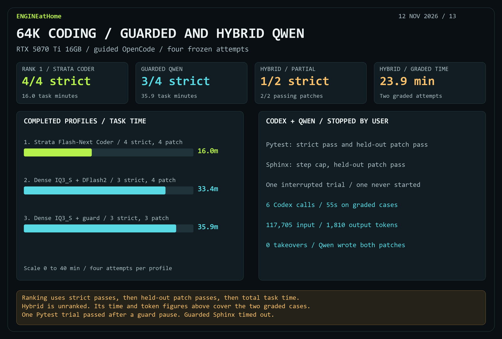

# 64K coding ranking and Qwen supervision pilot

**Strata Flash-Next GSQ-RCO Coder ranks first on the completed matched set.** It produced four passing patches with four normal completions in 16m 01s. The ranking orders completed four-attempt profiles by strict passes, then held-out patch passes, then total task time.

| Rank | Configuration | Strict | Patch | Total task time | Tool calls | GPU-only energy |
| ---: | --- | ---: | ---: | ---: | ---: | ---: |
| 1 | Strata Flash-Next Coder | 4/4 | 4/4 | 16m 01s | 122 | 24.63 Wh |
| 2 | Dense IQ3_S + DFlash2 depth 7 | 3/4 | 4/4 | 33m 26s | 228 | 111.31 Wh |
| 3 | Dense IQ3_S + DFlash2 depth 7 + loop guard | 3/4 | 3/4 | 35m 57s | 213 | 108.69 Wh |

The guard paused on the third identical shell command and normalized result when the patch fingerprint stayed unchanged. The final guarded Pytest trial resumed and passed in 4m 10s, compared with 13m 11s in the earlier unguarded run. Guarded Sphinx resumed after a pause, then timed out and failed held-out grading.

## Partial Codex-supervised run

The user stopped the run after two grades. One later Pytest attempt was interrupted and the final attempt remained queued.

| Graded case | Time | Strict | Patch |
| --- | ---: | ---: | ---: |
| Pytest #6202, first trial | 8m 32s | Pass | Pass |
| Sphinx #10323 | 15m 21s | Step cap | Pass |

Across those two cases, the hybrid spent **23m 53s** and made **166 tool calls**. Codex supplied a brief, one correction and a final review for each case. Its six calls took **54.86s** and used **117,705 input tokens** including **53,248 cached**, plus **1,810 output tokens**. Qwen wrote both patches. The interrupted attempt completed one additional Codex brief before the stop. Including that brief, the experiment recorded **135,581 input tokens** including **64,384 cached**, and **1,991 output tokens**. These are CLI usage counters from the signed-in account. Dollar cost was unavailable.

Both new profiles used the same frozen tasks, 65,536-token capacity, guided OpenCode settings and independent offline grader. The hybrid used a read-only GPT-6 Sol supervisor at task boundaries. The hybrid result remains unranked. GPU energy above is sampled and device-wide, and covers the coding windows.

[Measurements JSON](results/dense-iq3s-supervision-20261112.json) · [Dense vs. Strata live coding and retrieval](dense-iq3s-live-20261112.md)
