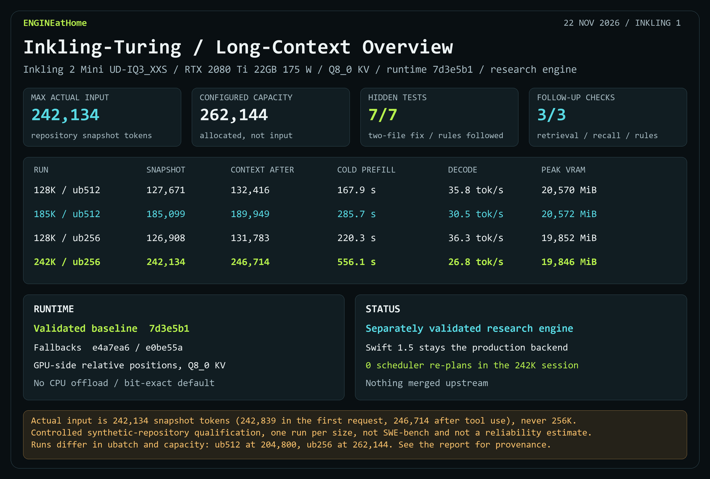
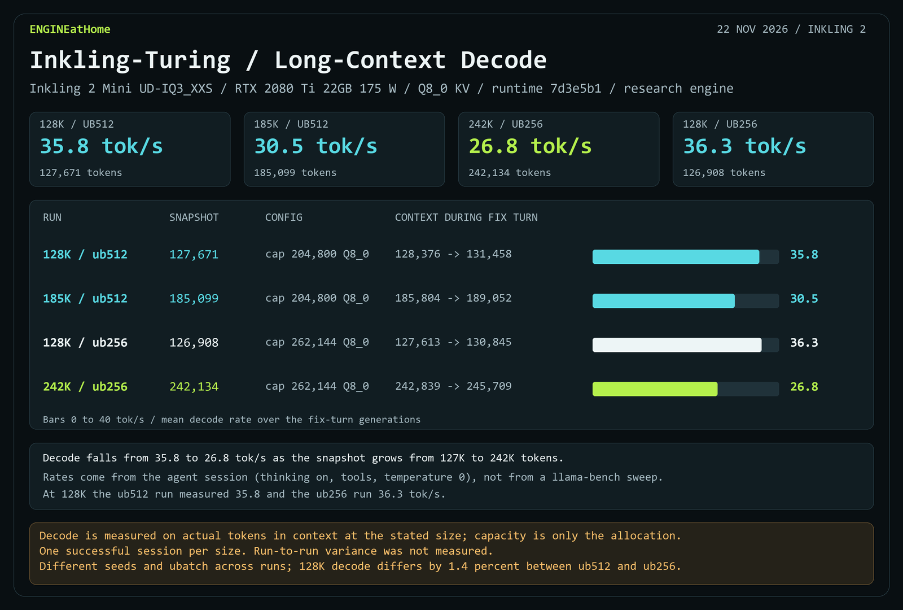
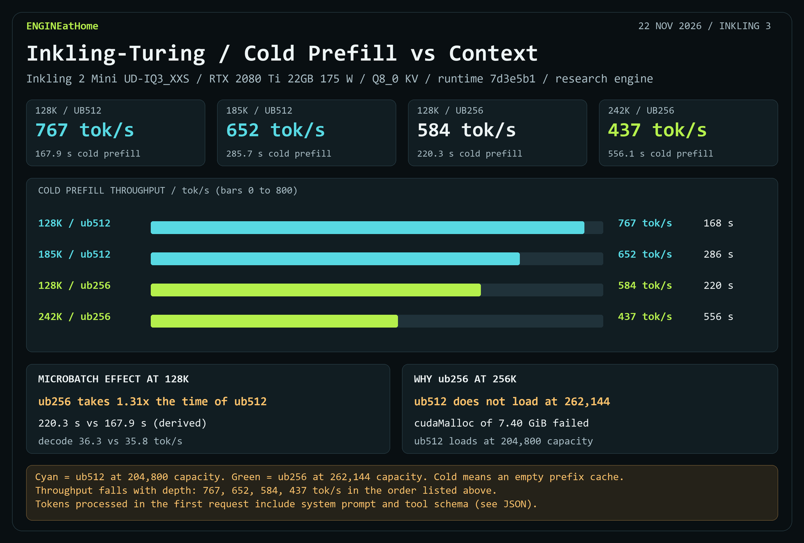
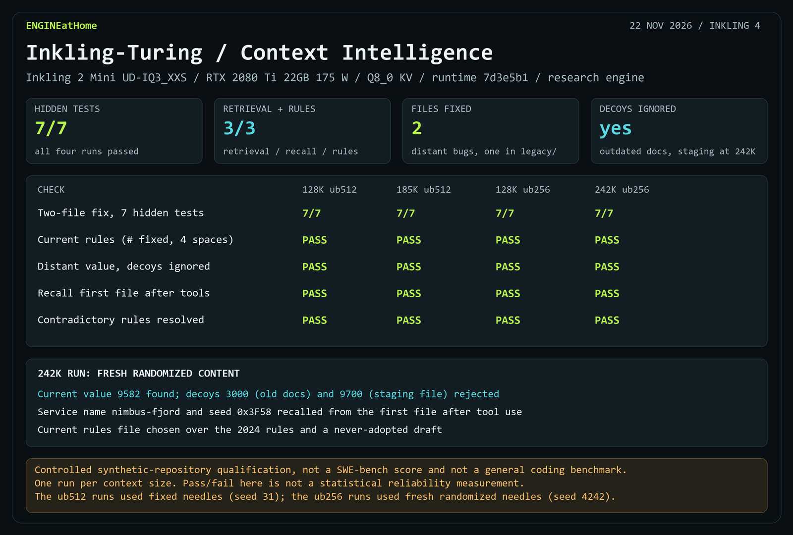
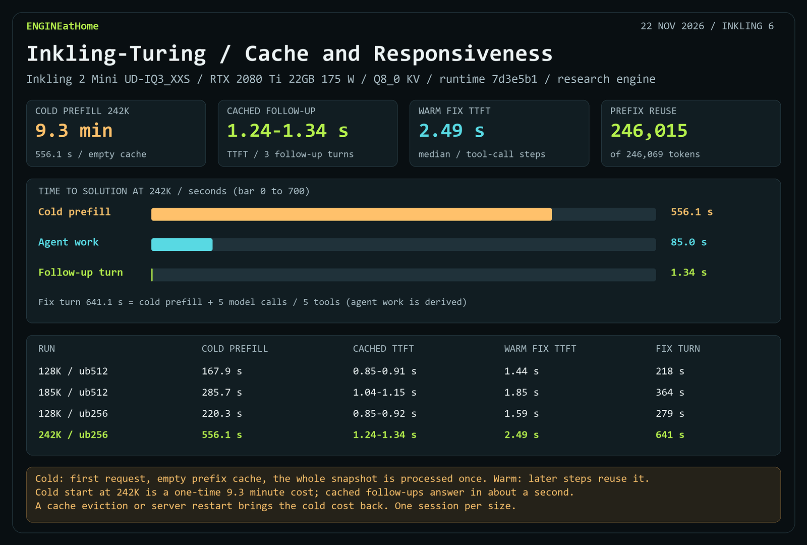
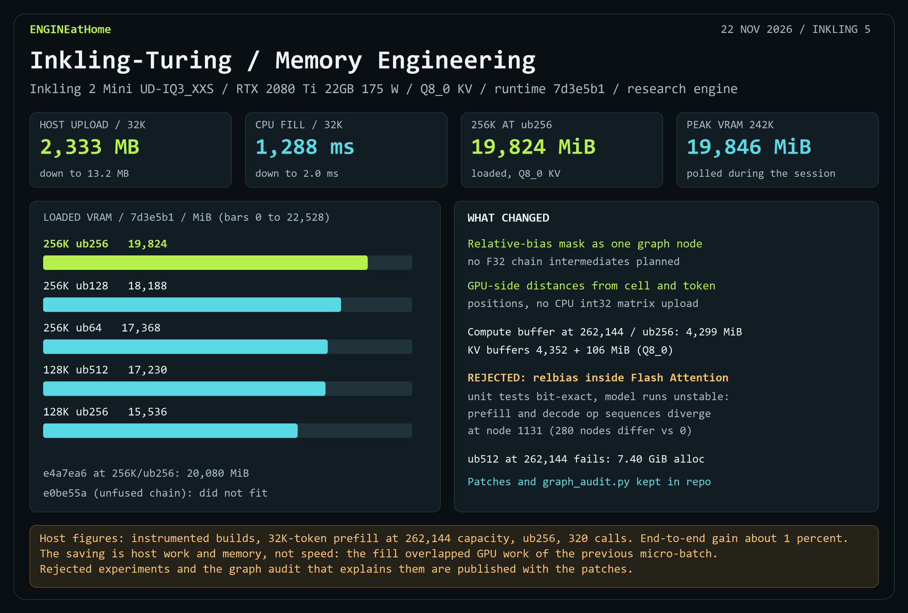

# Inkling-Turing: long-context CUDA engineering on an RTX 2080 Ti (22 November 2026)

Inkling-Turing is a separately validated research engine: Inkling 2 Mini (UD-IQ3_XXS) on an RTX 2080 Ti 22 GB at 175 W, served by a llama.cpp fork with sm_75 kernels and a GPU-side relative-position path. **Swift 1.5 remains the selected production backend**; nothing here replaces it, and nothing was merged upstream.

- Validated runtime baseline: **`7d3e5b1`**. Fallbacks: **`e4a7ea6`** (single relbias node with a dense distance matrix) and **`e0be55a`** (validated build before the relbias work).
- Largest qualified actual input: **242,134 snapshot tokens** in a 262,144-token window (246,714 tokens in context after the session). It is not a 256K actual-input run.
- Evidence: [measurements JSON](results/inkling-turing-20261122.json), [raw results and logs](../research/inkling-turing/v06-longctx/results/), [long-context readiness report](../research/inkling-turing/v06-longctx/LONGCTX_READINESS.md), [full research bundle](../research/inkling-turing/).

## What was measured

A controlled synthetic-repository qualification, **not SWE-bench**. Each session loads one repository snapshot (a synthetic Python project with filler modules and a few special files) into the first user message, then runs four turns in a real docker sandbox with normal shell tools, temperature 0 and the prefix cache on:

1. **Fix:** `tests/test_summary.py` fails; fix two bugs in two distant files (one under `legacy/`, which the superseded 2024 rules forbid and the current rules allow), follow the current rules (4 spaces, a `# fixed` comment above every changed function) and verify. Graded by 7 hidden tests plus a rules check.
2. **Retrieval:** which constant sets the retry budget in effect, its value and its consumer, with outdated documentation, a legacy constant and (in the 242K run) a staging file as decoys.
3. **Recall:** from memory, two constants of the first file in the snapshot after all the tool use.
4. **Contradictory rules:** which rules file is current and what it says.

### Token accounting (never mix these)
| term | meaning |
|---|---|
| configured capacity | the `-c` allocation (204,800 or 262,144) |
| snapshot tokens | tokenizer count of the repository text (`/tokenize`) |
| first-request prompt tokens | snapshot plus system prompt, chat template and tool schema |
| context after the session | tokens in context after the last turn (tool output and answers included) |
| cold / cached | cold = empty prefix cache, whole prompt processed; cached = only new tokens processed |

## Results

Same binary (`7d3e5b1`), Q8_0 K and V, Flash Attention, one slot, full CUDA, no CPU offload. Four sessions on two server configurations.

| run | capacity | ubatch | snapshot tokens | first-request prompt | context after | cold prefill | prefill tok/s | decode tok/s | fix turn | hidden tests | follow-ups | peak VRAM |
|---|---|---|---|---|---|---|---|---|---|---|---|---|
| 128K | 204,800 | 512 | 127,671 | 128,376 | 132,416 | 167.9 s | 766.7 | 35.8 | 218 s | 7/7 | 3/3 | 20,570 MiB |
| 185K | 204,800 | 512 | 185,099 | 185,804 | 189,949 | 285.7 s | 652.5 | 30.5 | 364 s | 7/7 | 3/3 | 20,572 MiB |
| 128K | 262,144 | 256 | 126,908 | 127,613 | 131,783 | 220.3 s | 583.7 | 36.3 | 279 s | 7/7 | 3/3 | 19,852 MiB |
| **242K** | 262,144 | 256 | **242,134** | 242,839 | **246,714** | **556.1 s** | 437.3 | 26.8 | 641 s | 7/7 | 3/3 | **19,846 MiB** |

- The ub512 sessions used fixed needles (seed 31); the ub256 sessions used freshly randomized needles and decoys (seed 4242: retry budget 9582 against decoys 3000 and 9700, service `nimbus-fjord`, seed `0x3F58`).
- Decode rates are means over the fix-turn generations inside an agent session (thinking on, tool calls), not a `llama-bench` sweep.
- Prefill rates are the server-reported rate of the first request; the first request of the 128K ub256 run carried 646 cached system tokens.
- **One successful run per context size. This is a qualification, not a statistical reliability measurement.**

### Microbatch effect
At 128K, ub256 takes 1.31 times as long to cold-prefill as ub512 (220.3 s against 167.9 s, derived); decode differs by 1.4 percent. ub512 at 204,800 loads at 20,542 MiB; **ub512 at 262,144 does not load** (a 7.40 GiB `cudaMalloc` for the compute buffer fails), so ub256 is the setting that reaches the full 262,144-token window. The ub256 and ub512 runs also differ in seed, content and capacity, so this comparison is indicative, not a controlled A/B.

### Cache and responsiveness
| 242K, ub256 | value |
|---|---|
| cold prefill | 556.1 s (9.3 minutes) |
| fix turn, total | 641.1 s (5 model calls, 5 tool calls, all ok) |
| warm TTFT in the fix turn, median | 2.49 s |
| cached follow-up TTFT (3 turns) | 1.24 to 1.34 s |
| prefix reuse on the first follow-up | 246,015 of 246,069 tokens |

Cold start is a one-time cost per snapshot; cached steps answer in about a second. A cache eviction or server restart brings the cold cost back.

### Stability
The 242K session server log (verbosity 4) contains no `sched_graph_realloc` lines (no scheduler re-plans) and no CUDA errors; the scheduler graph is the 11,740 nodes / 2 splits that were reserved. This build does not log CUDA-graph reuse, so "stable" means: no crash, no re-plan and no stale-pointer symptom across all calls.

## Memory engineering

Inkling's per-head relative-position bias is the memory driver at long context: the compute buffer grows with `ubatch x n_kv`. The work, in order, with the fallbacks kept:

| step | commit | what changed |
|---|---|---|
| validated build | `e0be55a` | unfused relbias chain of F32 intermediates; 256K at ub256 did not fit (ledger V03-RN) |
| relbias as one graph node | `e4a7ea6` | the allocator no longer plans the F32 chain; 256K/ub256 loads at 20,080 MiB; bit-exact |
| GPU-side relative positions | **`7d3e5b1`** | the node derives distances from cell and token positions; the CPU-built int32 `[n_kv, n_tokens]` matrix and its upload are gone; bit-exact |

Measured on instrumented builds, 32K-token prefill at 262,144 capacity, ub256, 320 calls (`hostcost_*` logs):

| | e4a7ea6 | 7d3e5b1 |
|---|---|---|
| CPU fill | 1,288.5 ms | 2.0 ms |
| H2D copy | 170.4 ms | 0.9 ms |
| uploaded | 2,333 MB | 13.2 MB |
| 256K / ub256 loaded | 20,080 MiB | 19,824 MiB |

The end-to-end prefill gain is only about 1 percent (the host fill overlapped GPU work of the previous micro-batch), so this is a host-work and memory result, not a speed result. Loaded VRAM of `7d3e5b1` (q8_0): 256K/ub256 19,824 MiB, 256K/ub128 18,188, 256K/ub64 17,368, 128K/ub512 17,230, 128K/ub256 15,536. At 262,144 / ub256 the compute buffer is 4,299 MiB and the Q8_0 KV buffers 4,352 + 106 MiB.

## Rejected: relative bias inside Flash Attention

Computing the bias in the mma tile loader would remove the dense per-head F16 mask (about 48 of 51 bytes per `ubatch x n_kv` element). Two integration variants were built; kernel unit tests were bit-exact (including q8_0 K/V), but model runs were unstable. A CPU/CUDA graph audit (`research/inkling-turing/v06-longctx/graph_audit.py`) explains the failure at topology level: the llama graphs have the same node count in the reserved, prefill and decode graphs (11,740 on CUDA), but the fused variant makes the prefill and decode **op sequences** diverge from node 1131 (280 nodes with different sources, against 0 for the unfused build), so the scheduler's reserved allocation does not fit both and it re-plans (the 11,862 in the scheduler log is the post-split graph). It also fails with CUDA graphs disabled. The exact corrupting access was not located. The patches, scripts and the audit are kept; the audit is the gate any future fusion must pass (equal op sequence and sources, zero live-range overlaps, zero re-plans) on a CPU build before any GPU test.

## Earlier kernel work (v0.1 to v0.3), ledger-recorded
Bit-exact by default, measured against the pure public fork with llama-bench in the same session (`ledger.jsonl` ids A2, P4, P6; the raw llama-bench JSON stays on the research host and is not bundled): decode +9.5 percent at 0K and +6.3 percent at 8K (checkpoint 3: 56.99 to 62.38 and 53.11 to 56.45 tok/s), then prefill steps of +7.4 percent (P4) and +5.0 percent (P6) over their same-session controls at pp512. No matched comparison with unmodified upstream llama.cpp exists for this model (the only upstream figures in the notes are approximate), so none is published.

## Limitations
- One run per context size and per configuration; no variance estimate.
- Synthetic repository with a fixed task shape, not a real-repository benchmark and not SWE-bench.
- Largest actual input 242,134 snapshot tokens (246,714 after tool use); the last roughly 15K tokens of the window were not exercised.
- Cold prefill at 242K is 9.3 minutes; interactive use requires a warm prefix cache.
- The ub512 and ub256 sessions differ in capacity, seed and content.
- Research engine: single GPU, Turing only, head size 128 only for the relbias work; nothing upstreamed.

## Reproduce
1. Rebuild: apply `research/inkling-turing/patches/0001..0018` to `realugbun/llama.cpp@inkling2-speed` commit `7669d89` (gives `e0be55a`), then `0019` (`e4a7ea6`) and `0020` (`7d3e5b1`); see [research/inkling-turing/README.md](../research/inkling-turing/README.md).
2. Serve (ub256 at 256K): `llama-server -m <Inkling-2-Mini-UD-IQ3_XXS.mainline.gguf> -ngl 99 -fa on -ctk q8_0 -ctv q8_0 -c 262144 -ub 256 -np 1 --jinja --no-warmup -lv 4`.
3. Run: `python research/inkling-turing/v06-longctx/pilot_ctx.py --port 
 --sizes 244000,128000 --ctx 262144 --vary --seed 4242 --max-tokens 4000 --first-timeout 244000=1100,128000=420 --turn-timeout 90` (needs the docker sandbox image built from `research/inkling-turing/v03-strata/agent-eval/Dockerfile`).
4. Regenerate the JSON and cards: `python bench/build_inkling_results.py && python bench/render_cards.py` (cards need Pillow and Consolas or DejaVu Sans Mono).

## Provenance
Every figure above is read by `bench/build_inkling_results.py` from files under `research/inkling-turing/v06-longctx/results/`:

| metric | source file |
|---|---|
| runs at ub512 (128K, 185K) | `ctx_results_ub512_128k_185k.json`, `session_k_ctx_ub512_20261122.log` |
| runs at ub256 (128K, 242K) | `ctx_results_ub256_128k_242k.json`, `session_k_256_ub256_20261122.log`, `server_ub256.log` |
| re-plan count, compute and KV buffers | `server_summary.txt` (from `server_ub256.log`) |
| ub512 at 262,144 allocation failure | `session_k_256_ub256_20261122.log`, `server_ub512_probe.log` |
| host fill / copy / upload | `hostcost_e4a7ea6_k_depth_20261122.log`, `hostcost_memprobe_7d3e5b1_k_b2_20261122.log` |
| loaded VRAM table | `hostcost_memprobe_7d3e5b1_k_b2_20261122.log` |
| graph audit | `research/inkling-turing/v06-longctx/audit/` |

The raw files are the originals from the research host with machine-specific paths removed; the result JSON files were checked to be identical to the originals.
