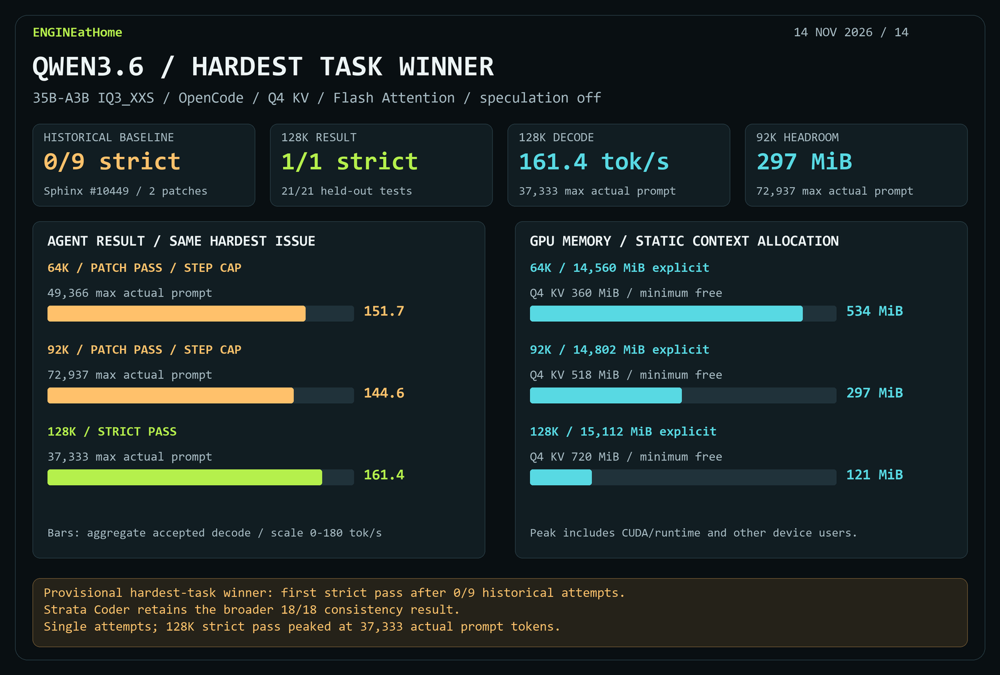

# Qwen3.6 hardest-task result and context allocation

**Qwen3.6-35B-A3B IQ3_XXS is the provisional hardest-task winner.** It produced the first strict pass on `sphinx-doc__sphinx-10449` in the saved campaign history after nine prior attempts produced zero strict passes and two passing patches. This is a single-task distinction; Strata Flash-Next Coder retains the broader 18/18 consistency result.

| Metric | 64K | 92K | 128K |
| --- | ---: | ---: | ---: |
| Strict completion | Step cap | Step cap | **Pass** |
| Held-out patch | **21/21** | **21/21** | **21/21** |
| Task time | 8m 15s | 5m 25s | 5m 54s |
| Aggregate decode | 151.68 tok/s | 144.57 tok/s | **161.37 tok/s** |
| Aggregate fresh prefill | **3,938.47 tok/s** | 2,983.56 tok/s | 2,820.73 tok/s |
| Maximum actual prompt | 49,366 | **72,937** | 37,333 |
| Tool calls | 98 | 99 | 60 |

## GPU allocation

| Allocation | 64K | 92K | 128K |
| --- | ---: | ---: | ---: |
| Model buffer | 13,956 MiB | 13,956 MiB | 13,956 MiB |
| Q4 KV buffer | 360 MiB | 518 MiB | 720 MiB |
| CUDA compute buffer | 244 MiB | 328 MiB | 436 MiB |
| Explicit buffers | 14,560 MiB | 14,802 MiB | 15,112 MiB |
| Sampled device peak | 15,462 MiB | 15,699 MiB | 15,875 MiB |
| Minimum device VRAM free | **534 MiB** | 297 MiB | 121 MiB |

All profiles used llama.cpp b12110 CUDA13, all 99 layers on the GPU, Q4_0 K/V cache, Flash Attention, batch 2,048, microbatch 512, one slot and a 16,384-token output limit. Speculative decoding, context shifting and prefix-cache RAM were disabled. The model SHA-256 is `4eb30af2df0dde76fe8d0a60f0e88f285ee668dcb1b8da892ee5c13dd6b00399`.

The 64K and 92K attempts both produced independently passing patches but exhausted the 100-call OpenCode ceiling before a normal final answer. The 128K attempt completed normally in 61 API calls. These are independent single attempts, so their different trajectories prevent treating task duration as an isolated context-size speed comparison.

The 92K profile is the practical capacity compromise: it exercised 72,937 actual prompt tokens and retained 297 MiB sampled VRAM headroom. The 128K profile fit completely, but its 121 MiB margin is operationally fragile. Its strict pass used only 37,333 actual prompt tokens, so useful agent reasoning above 64K remains unproven.

GPU energy and VRAM peaks are sampled device-wide counters and can include other applications. Process RSS can include mapped/shared pages. Raw model traces, weights and binaries remain local.

[Measurements JSON](results/qwen36-hardest-context-20261114.json)
