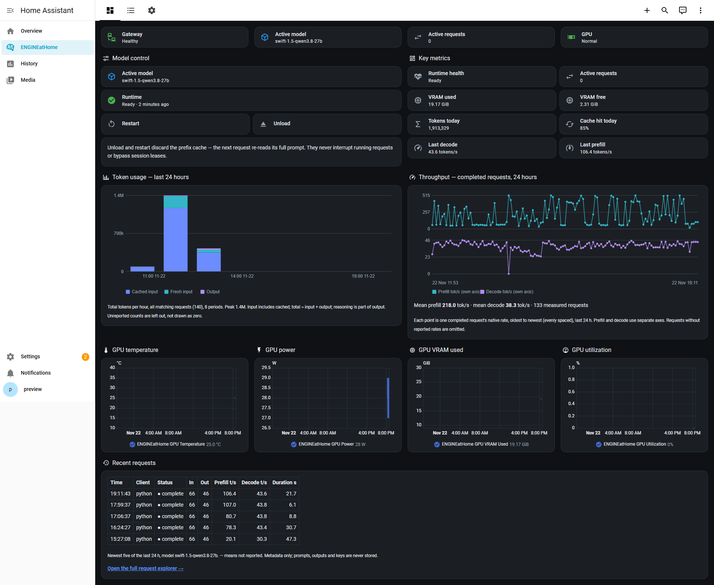
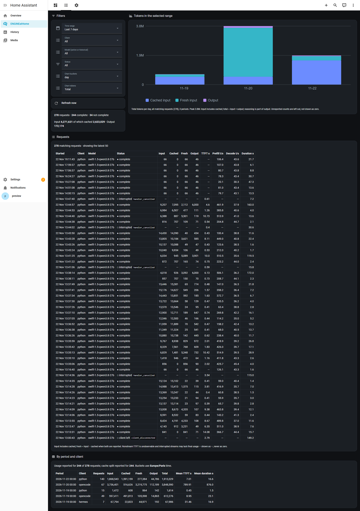
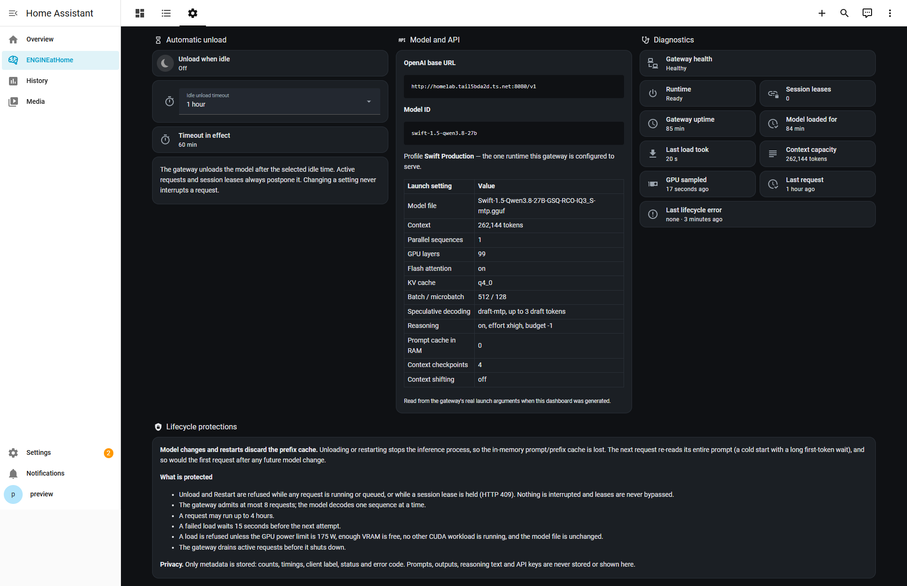

# ENGINEatHome Serving dashboard

Redesigned 2026-11-22. A Home Assistant dashboard for the homelab inference gateway: dark charcoal surfaces, a responsive 12-column Sections layout, three views. It only changes Home Assistant configuration (package, dashboard, theme). The gateway, lifecycle logic, inference arguments, credentials and API are untouched.

Dashboard URL: `http://homelab.tail5bda2d.ts.net:8123/engine-at-home/overview` (`/requests`, `/settings`). The old `/serving` path is replaced by `/overview`.



## Views

**Overview**: a status header (gateway health, active model, active requests, GPU status), a **Model control** panel, key metrics, and separate charts:

- Token usage, last 24 h: cached input, fresh input, output (stacked; one tokens axis).
- Throughput: prefill and decode tok/s per completed request, on their own axes.
- GPU temperature (°C), power (W), VRAM used (GiB) and utilization (%), each in its own native history chart. Units are never mixed.
- The five most recent requests with a link to the explorer.

Model control shows the **actual** runtime state and the model actually in memory. Load is offered only when the model is unloaded or failed; Restart and Unload only when ready, each behind a confirmation that states the cost (the prefix cache is discarded, so the next request re-reads its whole prompt). A banner appears while the gateway refuses Unload/Restart because requests or session leases are active. Nothing here interrupts a request or bypasses a lease; the gateway still enforces that (HTTP 409).

**Requests**: filters for time range, client, model (active or historical), status, and chart bucket/series; a stacked token chart for the selection; a table of the latest 50 matching requests (input, cached, fresh, output, TTFT, prefill, decode, duration, status/error); and a per-period/client table. Metadata only.

**Settings**: automatic unload switch and idle timeout (15 min – 24 h, applied through the existing `PATCH /admin/settings`), API URL and model ID, the real launch settings, diagnostics (uptimes, leases, last load time, GPU sample age, last error) and the lifecycle protections, including the prefix-cache warning.

| Overview, phone | Requests | Settings |
|---|---|---|
|  |  |  |

Screenshots are real renders of this configuration in an isolated Home Assistant instance (2026.10.2) reading the live gateway's metadata.

## Design decisions and limits

- **Native only.** The deployment has no HACS, no custom cards and no Lovelace resources, so ApexCharts and Mushroom are not used. The dashboard uses Sections, Tile, Heading, Gauge, Conditional, Entities, History-graph and Markdown cards plus a theme (`themes/engineathome.yaml`, applied per view). Token and throughput charts are inline SVG rendered by HA templates from real request rows. They are not interactive: no tooltips or zoom.
- **Theme scope.** The theme styles the dashboard content. HA's own top bar and sidebar follow your HA theme; select *ENGINEatHome* in your profile for a fully dark shell.
- **No profile selector.** The gateway serves exactly one model (`swift-1.5-qwen3.8-27b`, one `argv`, one port). A Swift / Inkling profile dropdown would be non-functional, so it is not shown. **Backend dependency:** model profiles need gateway support for several named launch profiles, an explicit select-then-apply control endpoint (selecting must never load), per-profile preflight (VRAM, power limit, checksum), and a recorded active-profile field in `/admin/status`. The dashboard needs only a profile list and an active-profile sensor once that exists. Until then the interface states that Unload, Restart (and any future model change) discards the prefix cache.
- **Status filter** is applied in the dashboard over the newest 500 rows returned by the existing analytics API; no gateway change.
- **Unavailable is not zero.** Missing measurements (no decode rate, no cache split, nonstream TTFT) show `—`/Unavailable. Chart series ignore unreported counts, and "input, split unreported" is its own series.
- **Request table width.** Wide tables clip on phones; the Overview table is a compact eight-column version.
- Overview charts use fixed 24-hour windows; Requests charts follow the filters. GPU history graphs use HA's recorder (default retention), so they are empty right after a fresh install.

## Files

| File | Role |
|---|---|
| `serving/ha_dashboard.py` | dashboard and theme generator, chart/table templates |
| `serving/ha_files.py` | package generator (REST sensors, derived template sensors, helpers, commands), runtime facts from real `argv` |
| `serving/install_home_assistant.py` | backs up, installs package/dashboard/theme, validates with HA `check_config`, rolls back on failure |
| `serving/configure.py` | passes the real launch arguments to the generator |
| `serving/test_ha_dashboard.py` | offline checks: YAML, every entity defined, native cards only, secrets, templates and SVG with null/empty data |
| `serving/validate_ha_history.py` | isolated HA instance against the real metadata API: filters, every status and token view, invalid ranges |

Regenerate and install (on the homelab; no key is printed):

```bash
cd ~/llm/serving
~/llm/serving-venv/bin/python -c "import json,pathlib;from ha_files import generate;c=json.loads(pathlib.Path('config.json').read_text());k=json.loads(pathlib.Path('credentials.json').read_text());generate(pathlib.Path('ha-generated'),c['api_base_url'].rsplit('/v1',1)[0],c['model_id'],k['home-assistant'],c['argv'])"
sudo ~/llm/serving-venv/bin/python install_home_assistant.py   # backup, check_config, rollback on failure
sudo docker restart homeassistant                             # package changes need a restart
```

Rollback: copy the files from `engineathome/backup-<stamp>/` back over `engineathome/` (and remove `themes/engineathome.yaml`), then restart HA.

Offline tests: `python serving/test_ha_dashboard.py` (needs `pyyaml` and `jinja2`). Against real HA: copy a generated candidate into the HA container and run `validate_ha_history.py <dir>`; it uses a temporary HA state and only reads metadata.
