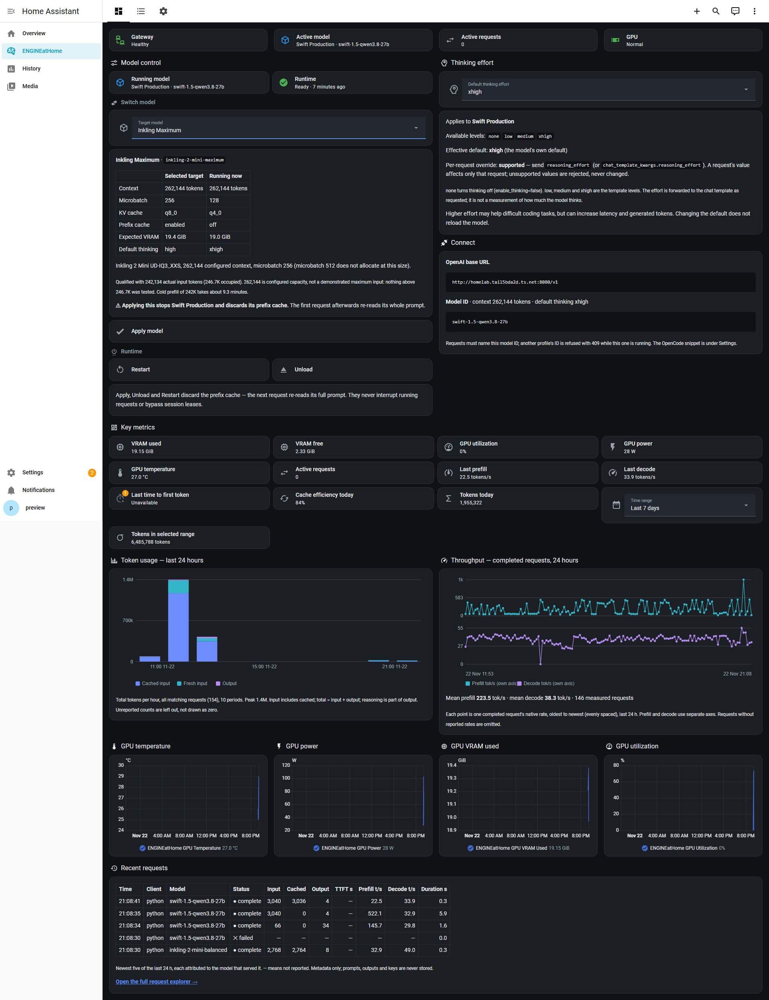
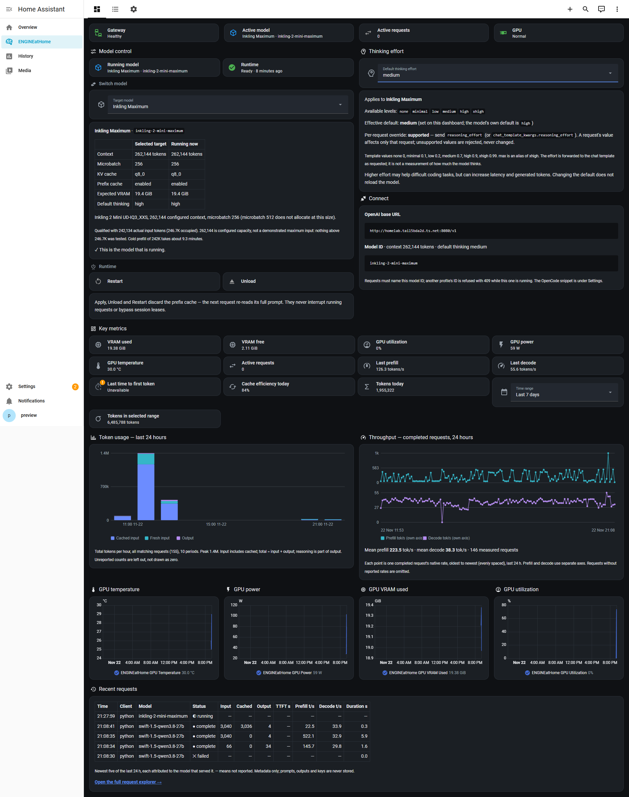
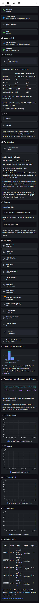

# ENGINEatHome Serving dashboard

A Home Assistant console for the homelab inference gateway: dark charcoal surfaces, a responsive 12-column Sections layout, three views. It chooses models and thinking effort, shows live GPU and inference statistics, and never holds a credential. The backend behaviour it controls is described in [multi-model-control-center.md](multi-model-control-center.md).

Dashboard URL: `http://homelab.tail5bda2d.ts.net:8123/engine-at-home/overview` (`/requests`, `/settings`).


## Views

**Overview**

- Status header: gateway health, the model **actually running**, active requests, GPU status (green / amber / red).
- **Model control.** *Running model* (blue) and *Runtime* state are separate from the *Target model* dropdown. Choosing a target only records it. The panel then compares the target with what is running (context, microbatch, KV precision, prefix cache, expected VRAM, default thinking) and says whether applying stops the running model and clears its prefix cache. **Apply model** appears only when the target differs, nothing is running or leased, and asks for confirmation. Load (when unloaded or failed), Restart and Unload (when ready) are compact and confirmed. Switching, failed loads and a failed last switch have their own states, and a banner explains why a switch or unload is refused.
- **Thinking effort.** A separate selector offering only the loaded model's levels, the effective default and its source, whether per-request override is supported, and a note that higher effort can raise latency and tokens. Changing it never reloads the model.
- **Connect.** API base URL, the served model ID, its context and the thinking default (code blocks with a copy button; no key).
- KPI tiles (VRAM used/free, GPU utilization/power/temperature, active requests, last prefill/decode/TTFT/latency, cache efficiency, tokens today and in the selected range), then separate charts: token usage (cached, fresh, output), prefill and decode throughput (own axes), and GPU temperature, power, VRAM and utilization as individual history graphs. The five latest requests, each attributed to the model that served it, link to the explorer.

**Requests.** Filters for time range, client, model/profile (active or historical, discovered from usage), status, token category and chart buckets; a stacked token chart; the latest 50 matching requests (model, forwarded thinking effort, status/error, input, cached, fresh, output, TTFT, prefill, decode, duration); a per-period/client/model table. Metadata only.

**Settings.** Default launch profile, automatic unload and idle timeout, all models with IDs, context, KV, microbatch and VRAM, a verbatim OpenCode snippet for the served model, each model's thinking controls, the selected model's launch settings (from the gateway; no paths), diagnostics (uptimes, leases, last load, GPU sample age, last switch, last error) and the lifecycle protections.

| Switch pending | Inkling Maximum running |
|---|---|
|  |  |

| Phone | Requests | Settings |
|---|---|---|
|  |  |  |

Screenshots are real renders of this configuration (Home Assistant 2026.10.2, headless Edge) reading the live gateway; the switch screenshots come from clicking through the real UI.

## Design decisions and limits

- **Native only.** No HACS, custom card or Lovelace resource is installed, so ApexCharts and Mushroom are not used. The dashboard uses Sections, Tile, Heading, Conditional, Entities, History-graph and Markdown cards and one theme (`themes/engineathome.yaml`, per view). Token and throughput charts are inline SVG rendered by Home Assistant templates from real request rows: not interactive (no tooltips or zoom).
- **Everything about profiles comes from the gateway's registry.** Dropdown choices, model IDs, levels and launch settings are generated from the configured profiles and read live from `/admin/status`; nothing is hard-coded.
- **Selection is a request, not an action.** No automation can apply a profile; only the confirmed Apply tile can. A gateway refusal (409) leaves the selection and the running model untouched, and the sync automations show the gateway's truth.
- **Unavailable is not zero.** Missing measurements show `—` or Unavailable. Chart series ignore unreported counts; "input, split unreported" is its own series.
- **Theme scope.** The theme styles the dashboard content. Home Assistant's own top bar and sidebar follow your theme; select *ENGINEatHome* in your profile for a fully dark shell.
- **Tables** clip on phones; the Overview table is the compact one.
- Overview charts use a fixed 24-hour window; Requests charts follow the filters. GPU graphs use the recorder, so they are empty right after a fresh install.
- Thinking changes are requests to the gateway: after a failure the selector reverts to the gateway's value within two minutes.

## Files

| File | Role |
|---|---|
| `serving/ha_dashboard.py` | dashboard, theme, chart and table templates |
| `serving/ha_files.py` | package generator: REST/derived sensors, helpers, commands, automations; profile data from `profiles.py` |
| `serving/install_home_assistant.py` | backup, install package/dashboard/theme, `check_config`, rollback on failure |
| `serving/test_ha_dashboard.py` | offline checks: YAML, every entity defined, native cards only, secrets, profile-derived content, templates and SVG with null/empty/unavailable data |
| `serving/validate_ha_history.py` | isolated HA instance against the real API with control services stubbed |

Regenerate and install (on the homelab; no key is printed):

```bash
cd ~/llm/serving
~/llm/serving-venv/bin/python -c "import json,pathlib;from ha_files import generate;c=json.loads(pathlib.Path('config.json').read_text());k=json.loads(pathlib.Path('credentials.json').read_text());generate(pathlib.Path('ha-generated'),c['api_base_url'].rsplit('/v1',1)[0],k['home-assistant'],c)"
sudo python3 install_home_assistant.py      # backup, check_config, rollback on failure
sudo docker restart homeassistant           # package changes need a restart
```

Rollback: copy the files from `engineathome/backup-<stamp>/` back over `engineathome/`, remove `themes/engineathome.yaml`, restart Home Assistant.

Offline tests: `python -m unittest test_serving test_ha_dashboard` in `serving/` (needs `aiohttp`, `pyyaml`, `jinja2`). Against real Home Assistant: copy a generated candidate into the container and run `validate_ha_history.py <dir>`.

## Model details and cache cards (2026-11-23)

The Overview gained a **Model details** card for the served model (quantization, KV precision, MTP depth and threshold, RAM-prompt-cache setting, VRAM now and expected, recent prefill and decode speed, cache hit rate over the last 20 requests, cached follow-up versus cold TTFT, model-process and host RAM, qualification status), and four Key-metric tiles (cache hit rate, cached follow-up TTFT, cold prompt TTFT, model-process RAM). The target-model comparison and the model/launch tables show quantization, MTP, RAM cache and qualification status for every profile. They read the new `sensor.engineathome_cache` sensor (`cache` block of `GET /admin/status`) and the per-profile fields `quantization`, `mtp`, `ram_cache` and `qualification_status`. Details and verification: [obliterated-profile-and-ram-cache.md](obliterated-profile-and-ram-cache.md).
