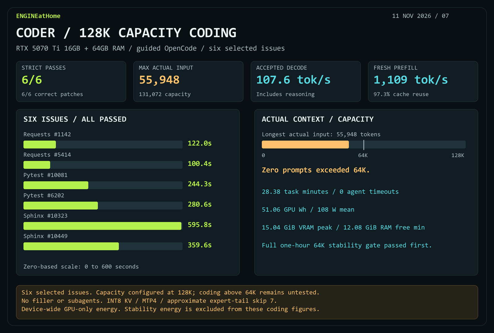

# Guided Coder coding with 128K capacity

**6/6 strict passes and 6/6 passing patches.** One attempt on each of six frozen SWE-bench Verified issues. The 64K handoff diagnostic and full one-hour stability gate passed before this separate coding stage loaded. No retries, subagents or prompt filler were used.

| Issue | Time | Strict / patch |
|---|---:|---|
| Requests #1142 | 122.0s | Pass / pass |
| Requests #5414 | 100.4s | Pass / pass |
| Pytest #10081 | 244.3s | Pass / pass |
| Pytest #6202 | 280.6s | Pass / pass |
| Sphinx #10323 | 595.8s | Pass / pass |
| Sphinx #10449 | 359.6s | Pass / pass |

Configured capacity was **131,072**; maximum actual input was **55,948 tokens**, with zero requests above65,536. This establishes successful operation at the configured capacity on these six issues, not reliability for coding prompts beyond64K. The prior synthetic near-filled128K probe checked only three retrieval markers and a short reply. Neither is a full SWE-bench score or a256K agent result.

| Measurement | Result |
|---|---:|
| Total task time / median | 28.38min / 262.45s |
| Accepted decode including reasoning | 107.62tok/s |
| Fresh prefill | 1,109.27tok/s |
| Prompt cache reuse | 97.32% |
| Native requests | 245 |
| Tool calls / native tool error states / shell failures | 215 / 14 / 20 |
| Agent / shell timeouts | 0 / 0 |
| GPU energy / mean / peak power | 51.06Wh / 107.91W / 266.73W |
| Peak temperature / mean utilization | 59.27C / 50.12% |
| Peak sampled VRAM / native RSS | 15.04GiB / 32.62GiB |
| Minimum available Windows physical RAM | 12.08GiB |

GPU coverage was100% of1,703.31 sampled agent seconds. Energy is device-wide GPU-only; no CPU or wall energy, and no overlapping parent telemetry. RSS may include mapped/shared pages. Native tool errors and shell failures have distinct scopes. Compaction count for coding is unavailable.

Settings: RTX5070Ti16GB/64GB DDR5, Strata0.1.59, expert-pruned Coder, INT8KV/MTP4/minp0.5/fullPLE/1,500MiB reserve/approximate expert-tail skip7. OpenCode1.18.16 high effort, requested reasoning1024/output8192/max100steps/1,200s/temp0/seed42, focused workflow guidance. Native and provider context limits both131,072. These are a different sample from the 18-attempt64K run; rate and duration differences do not isolate capacity effects.

Official runtime-stop succeeded, no native Strata process remained and the owner lock was absent. The queue ended before its deadline. Raw evidence: `bench/results/strata-coder-stability-handoff-20261111/agent128`.

[Measurements JSON](results/strata-coder-agent128-20261111.json) · [Preceding stability report](strata-coder-stability-handoff-20261111.md)
