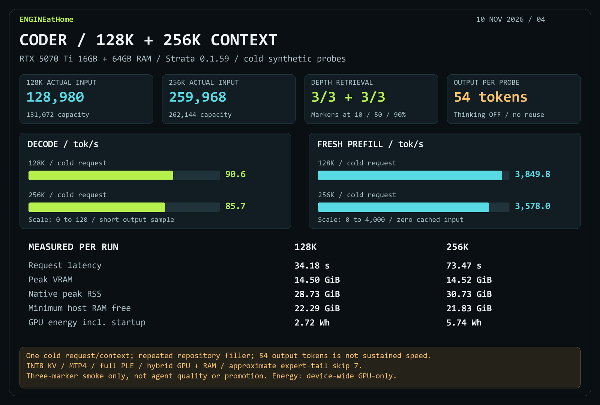

# Coder: quick 128K and 256K context probes

RTX 5070 Ti 16GB, 64GB DDR5; Strata 0.1.59 running ISTA-DASLab Qwen3.8-Flash-Next GSQ-RCO Coder. Both capacities loaded and returned all three retrieval markers correctly.

| Capacity | Actual input | Fresh prefill tok/s | Accepted decode tok/s | Request seconds | Markers |
|---|---:|---:|---:|---:|---:|
| 131,072 | 128,980 | 3,849.8 | 90.6 | 34.18 | 3/3 |
| 262,144 | 259,968 | 3,578.0 | 85.7 | 73.47 | 3/3 |

One cold request per capacity, zero cached prompt tokens, thinking OFF, 128-token output cap; each response finished normally after 54 tokens. Input repeats repository source with three retrieval records inserted at approximately 10%, 50% and 90% of text length. This is a basic fit/speed/retrieval smoke, not sustained decoding, comprehensive retrieval accuracy, coding-agent quality or a context promotion gate.

Configuration: INT8 KV, 32,768 resident KV cells with remaining KV streamed from RAM, MTP4/minimum probability 0.5, full PLE, full 256-expert Coder arena and 1,500 MiB VRAM reserve. Default expert-tail skip 7 remains approximate. No attention-window or RoPE overrides were introduced for these probes. Both runtimes officially unloaded afterward.

Resource and energy values in the [measurements JSON](results/strata-coder-long-context-20261110.json) cover startup through the request. Energy is device-wide GPU-only, with full sampled interval coverage; CPU and wall energy are unavailable. VRAM peaks are sampled; native RSS may include shared or mapped pages. The interrupted, ungraded coding attempt is excluded from quality totals.

Raw local evidence: `bench/results/coder-quick-131072-20261110` and `bench/results/coder-quick-262144-20261110`, including request, fixture, config, provenance, telemetry and official stop records. Raw prompts and local paths are excluded from publication.
