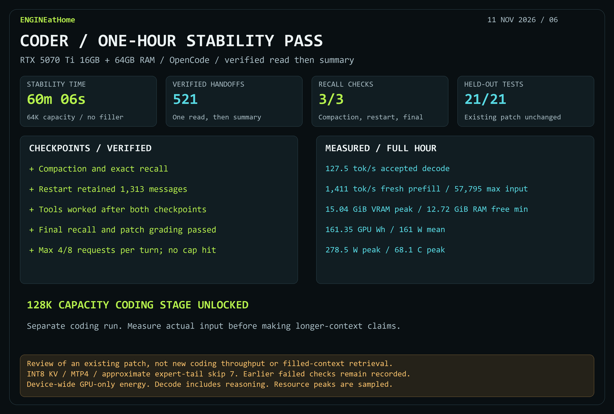

# Coder passed the one-hour 64K stability gate

The two-turn OpenCode review passed in **60m06s**: one verified read in a dedicated inspection turn, followed by a separate summary with tools disabled. There were **521 completed handoffs**, including 518 regular reviews and three checkpoint reviews. The eight-dispatch safety cap was never reached; the maximum was four. The shorter three-minute diagnostic passed separately and is excluded from these figures.

Explicit compaction, restart and all three marker/invariant recall checks passed. All **1,313 prior messages** survived the OpenCode process restart. Real reads were verified after both checkpoints. The marker was supplied only in the initial session instruction, and the summary guidance did not reinsert it. The existing patch stayed unchanged and **21/21 held-out checks passed**.

| Measurement | One-hour run |
|---|---:|
| Native accepted decode including reasoning | 127.54 tok/s |
| Fresh prefill | 1,411.23 tok/s |
| Maximum actual input | 57,795 tokens |
| Cache reuse | 96.72% |
| Peak sampled VRAM / native RSS | 15.04 / 32.48 GiB |
| Minimum available Windows physical RAM | 12.72 GiB |
| GPU energy / mean / peak power | 161.35 Wh / 161.10 W / 278.50 W |
| Peak temperature / mean utilization | 68.12°C / 81.92% |

Agent telemetry covered all 3,605.70 sampled seconds. Energy is device-wide GPU-only, with overlapping parent telemetry excluded; native RSS may include mapped/shared pages. Same Coder and native Strata settings: Strata 0.1.59, INT8 KV, MTP4/min-p 0.5, full PLE, approximate expert-tail skip 7. The review protocol changed, so these rates should not be interpreted as an isolated model speedup over earlier stability runs.

The old failed stability runs remain valid evidence. This later pass unlocked the separate 128K-capacity coding stage after official unload. Its scores and actual prompt lengths are reported separately. This is neither filled-64K retrieval validation nor evidence of agent reliability above 64K.

[Measurements JSON](results/strata-coder-stability-handoff-20261111.json) · [Earlier failure investigation](strata-coder-workflow-verdict-20261111.md)
