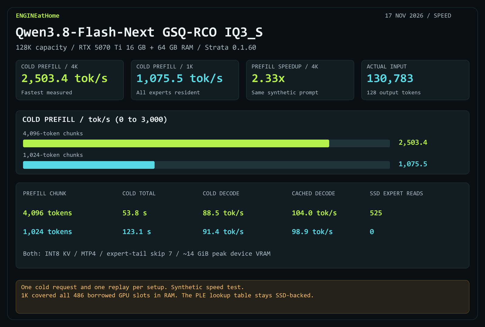

# Qwen3.8-Flash-Next GSQ-RCO IQ3_S at 128K

The **4,096-token chunk was faster** for the 130,783-token synthetic prompt. It delivered **2.33×** the cold prefill throughput and reduced cold wall time from **123.1 s to 53.8 s**. The 1,024-token setup kept every expert needed during prefill and decode in RAM or VRAM. Strata logged zero expert file reads after startup in that run.

Both runs used the ISTA-DASLab Qwen3.8-Flash-Next GSQ-RCO IQ3_S GGUF, Strata 0.1.60 on Windows, an RTX 5070 Ti 16 GB and 64 GB of system RAM. The shared settings were 131,072 context capacity, INT8 KV with 32,768 cells resident on the GPU, MTP depth 4 with minimum probability 0.5, expert-tail skipping at rank 7, full PLE and a 1,500 MiB VRAM reserve. The 1,024-token run lowered Strata's resident RAM headroom setting from 4 to 3.875 GiB. The PLE lookup table remained SSD-backed in both runs.

| Prefill chunk | Borrowed slots backed by RAM | Peak device VRAM | Minimum available system RAM |
|---|---:|---:|---:|
| 4,096 | 342 / 908 | 13.97 GiB | 0.55 GiB |
| 1,024 | 486 / 486 | 13.92 GiB | 1.85 GiB |

Each setup ran one cold request and one replay, with 128 generated tokens per request. Each replay reused 130,776 prompt tokens. This measures speed on a repeated-text prompt, with no coding quality or retrieval score. The chunk-size and headroom changes were measured together.

[Measurements JSON](results/strata-iq3s-128k-prefill-20261117.json)
