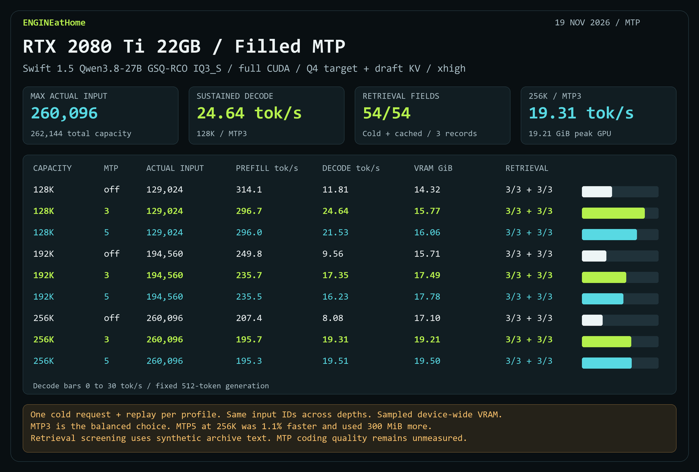
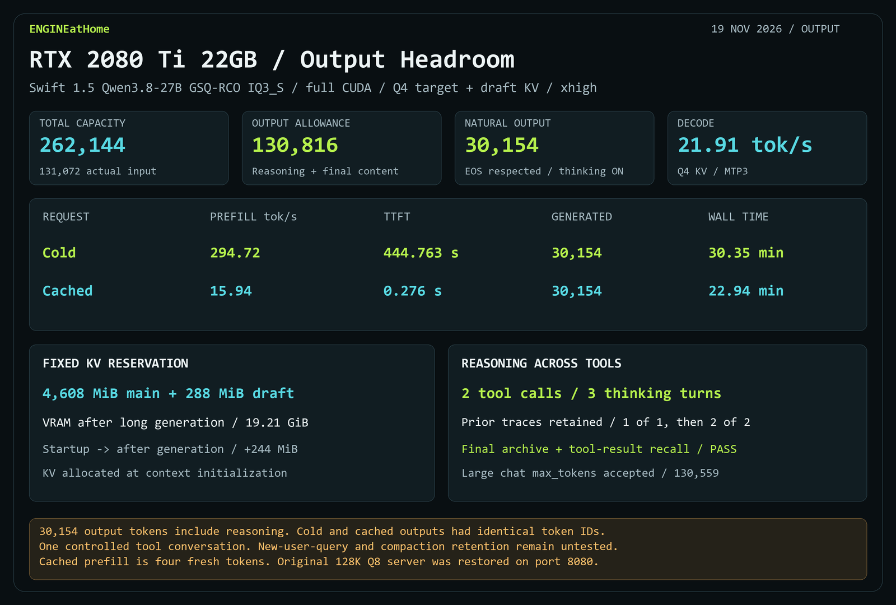
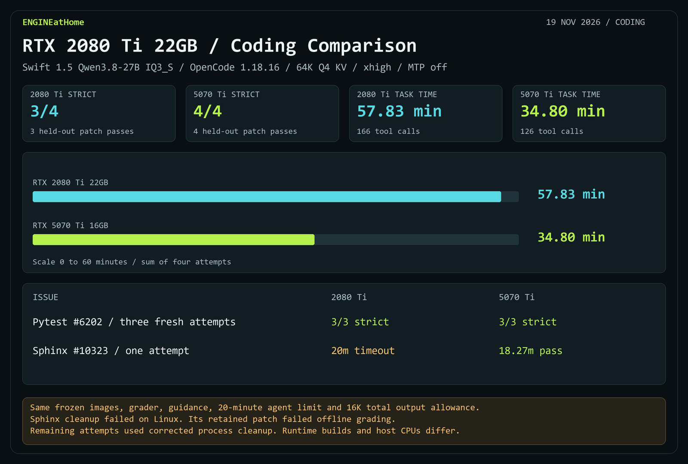

# RTX 2080 Ti 22GB / Swift 1.5 Qwen3.8-27B

Tested on an RTX 2080 Ti with 22,528 MiB reported memory, Ryzen 5 3600, 32GB system RAM, Ubuntu 26.04.1 LTS and NVIDIA driver 580.178.04. The native CUDA runtime is llama.cpp build 12519, commit 98d67c8d5. The original Windows comparison used an RTX 5070 Ti 16GB and a different runtime build and host CPU.

The model is Swift 1.5 Qwen3.8-27B GSQ-RCO IQ3_S with its MTP head, 12,120,016,896 bytes. SHA256 is `9aecf1cd41b2cb2f32a74e0d889e33855ebef43b26f43b43feb5720239e677e5`. Full CUDA weight placement includes token embeddings. Thinking uses verified xhigh template instructions and unrestricted reasoning. The total output allowance is recorded separately for every experiment. [Pinned checkpoint](https://huggingface.co/ukisai/Swift-1.5-Qwen3.8-27B-GSQ-RCO-GGUF/blob/d74895bbe5db4bec1e0024e7cc87d59c02d7631a/Swift-1.5-Qwen3.8-27B-GSQ-RCO-IQ3_S-mtp.gguf)

## Filled context and MTP

All nine profiles passed three-record retrieval cold and cached, giving 54/54 field checks. The contexts used 129,024, 194,560 and 260,096 actual input tokens, with identical token IDs across depths. MTP3 is the balanced measured choice. MTP5 at 256K was 1.1% faster on sustained decode and used 300 MiB more peak GPU memory. Each configuration has one cold sample and one replay, so that small gap needs repetition to establish consistency.

| Capacity | MTP off sustained tok/s | MTP3 sustained tok/s | MTP5 sustained tok/s |
| ---: | ---: | ---: | ---: |
| 128K | 11.81 | 24.64 | 21.53 |
| 192K | 9.56 | 17.35 | 16.23 |
| 256K | 8.08 | 19.31 | 19.51 |

The initial Q8/Q4 comparison also completed real 256K inference. Q8 at 256K passed retrieval but failed the final free-memory guard with 395 MiB free. The filled Q4 MTP matrix retained more than 2GB free even at MTP5.

[Initial Q8/Q4 and coding report](swift-homelab-20261118.md) · [Initial measurements](results/swift-homelab-20261118.json) · [Filled MTP report](swift-filled-mtp-homelab-20261118.md) · [Filled measurements](results/swift-filled-mtp-homelab-20261118.json)

## Output headroom and tool continuations

A 262,144-token allocation accepted 131,072 actual input tokens and a 130,816-token total output allowance. The model stopped naturally after 30,154 generated tokens. Cold and cached output token IDs matched. Cold prefill measured 294.72 tok/s and decode 21.91 tok/s. TTFT was 444.763 seconds cold and 0.276 seconds cached.

Main KV reserved 4,608 MiB and draft KV reserved 288 MiB at initialization. Device usage increased from 19,426 MiB at startup to 19,670 MiB after long generation, then stayed at that value on replay. All weights and both caches stayed on CUDA.

Two actual function calls completed across three assistant turns. Both earlier reasoning traces appeared intact in the final continuation prompt. The final response correctly combined the three archive keys and tool verification result. The template keeps reasoning after the last user query even with preserve_thinking=false. This test does not establish retention across a new user query or compaction.

[Headroom report](swift-headroom-homelab-20261118.md) · [Headroom measurements](results/swift-headroom-homelab-20261118.json)

## Coding quality comparison

| GPU | Strict passes | Held-out patches | Total task time | Tool calls |
| --- | ---: | ---: | ---: | ---: |
| RTX 2080 Ti 22GB | 3/4 | 3/4 | 57.83 min | 166 |
| RTX 5070 Ti 16GB | 4/4 | 4/4 | 34.80 min | 126 |

Both ran Pytest #6202 three times and Sphinx #10323 once with the frozen images, same grader and guidance, OpenCode 1.18.16, 64K Q4 KV, MTP off, unrestricted xhigh thinking, 16K total output per request, and a 20-minute agent limit.

The 2080 Ti Sphinx attempt timed out. Linux cleanup then failed on a Windows-only command. Its retained patch failed independent offline grading, and the two remaining Pytest attempts used corrected process cleanup. The failure and original artifacts remain in the evidence. Coding-agent quality with MTP remains unmeasured.

## Reproduction and evidence

The Homelab runners are [swift_homelab.py](../bench/swift_homelab.py), [swift_headroom.py](../bench/swift_headroom.py), [filled MTP report renderer](../bench/swift_filled_mtp_report.py) and [headroom report renderer](../bench/swift_headroom_report.py). Commands are listed in the individual reports. They require the pinned model, runtime and existing live audit. The coding benchmark additionally requires the frozen Docker images and OpenCode 1.18.16.

Each experiment captured the original 128K Q8 server command on port 8080, unloaded it for exclusive GPU use, then restored the exact command and verified health. Prompt IDs, rendered effort controls, outputs, per-process GPU allocation, sampled telemetry, grader evidence and restoration records are preserved in the archives.

- [Initial context and coding evidence](../bench/swift/evidence/2080ti-context-coding-20261118.tar.gz)
- [Filled MTP evidence](../bench/swift/evidence/2080ti-filled-mtp-20261118.tar.gz)
- [Headroom and tool evidence](../bench/swift/evidence/2080ti-headroom-20261118.tar.gz)
- [Archive SHA256 and sizes](../bench/swift/evidence-manifest.json)
- [Combined statistics used for cards](results/swift-2080ti-overview-20261119.json)

Regenerate the cards with Pillow installed.

    python -c "from bench.render_cards import swift_2080ti_cards; swift_2080ti_cards()"
