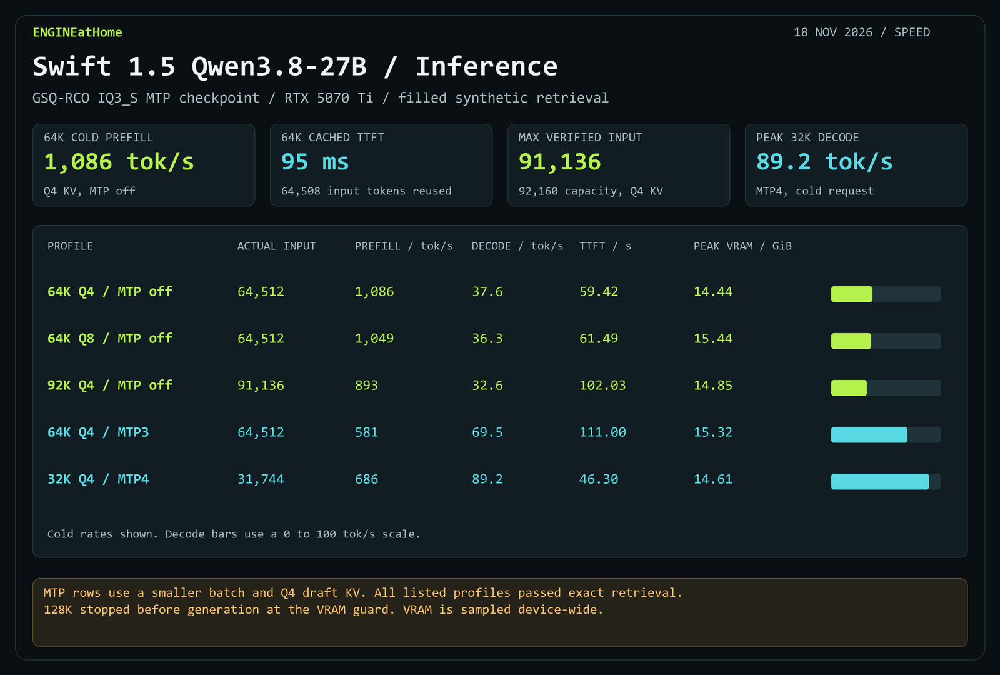
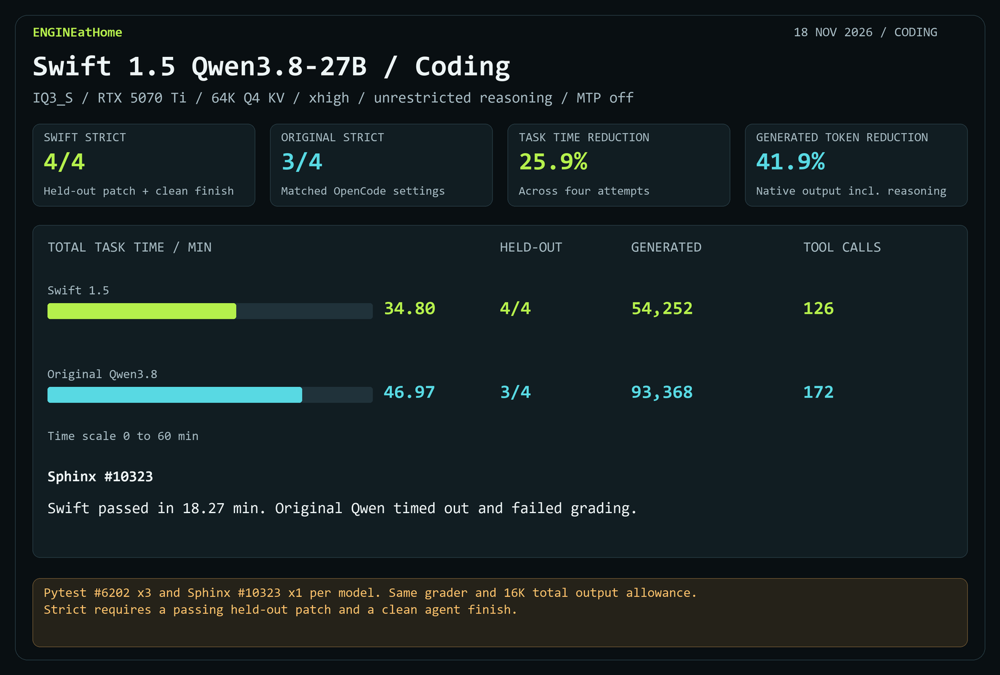

# Swift 1.5 Qwen3.8-27B on the RTX 5070 Ti

[Pinned IQ3_S MTP checkpoint](https://huggingface.co/ukisai/Swift-1.5-Qwen3.8-27B-GSQ-RCO-GGUF/resolve/d74895bbe5db4bec1e0024e7cc87d59c02d7631a/Swift-1.5-Qwen3.8-27B-GSQ-RCO-IQ3_S-mtp.gguf) · 12,120,016,896 bytes

SHA-256 `9aecf1cd41b2cb2f32a74e0d889e33855ebef43b26f43b43feb5720239e677e5` · version: 0.9.0-dev (build 12110, commit cd959bae9).

Native Windows CUDA, one sequence, full CUDA weight placement including the token embedding, Flash Attention, batch 512 and baseline microbatch 128. Both explicit xhigh and low were checked through rendered prompts. The xhigh render instructed the model to validate assumptions and consider alternatives, then opened the thinking block. The runtime used unrestricted thinking (`--reasoning-budget -1`). Sampling used temperature 1.0, top-p 0.95, top-k 20, min-p 0, presence penalty 0, repeat penalty 1, and seed 42.



## Inference results

| Capacity | KV | MTP | Batch / microbatch | Actual input | Cold prefill tok/s | Cold decode tok/s | Cold TTFT s | Cached TTFT s | Cached fresh/reused | Output cold/cached | Retrieval cold/cached | Draft accepted / proposed |
| ---: | --- | ---: | ---: | ---: | ---: | ---: | ---: | ---: | ---: | ---: | --- | ---: |
| 65,536 | q4_0 | 0 | 512 / 128 | 64,512 | 1,086.1 | 37.61 | 59.424 | 0.095 | 4 / 64,508 | 91 / 91 | pass / pass | — / — |
| 65,536 | q8_0 | 0 | 512 / 128 | 64,512 | 1,049.3 | 36.32 | 61.493 | 0.129 | 4 / 64,508 | 91 / 91 | pass / pass | — / — |
| 92,160 | q4_0 | 0 | 512 / 128 | 91,136 | 893.5 | 32.55 | 102.030 | 0.130 | 4 / 91,132 | 164 / 164 | pass / pass | — / — |
| 92,160 | q8_0 | 0 | 512 / 128 | — | — | — | — | — | — / — | — / — | — / — | — / — |
| 131,072 | q4_0 | 0 | 512 / 128 | — | — | — | — | — | — / — | — / — | — / — | — / — |
| 131,072 | q8_0 | 0 | 512 / 128 | — | — | — | — | — | — / — | — / — | — / — | — / — |
| 196,608 | q4_0 | 0 | 512 / 128 | — | — | — | — | — | — / — | — / — | — / — | — / — |
| 196,608 | q8_0 | 0 | 512 / 128 | — | — | — | — | — | — / — | — / — | — / — | — / — |
| 262,144 | q4_0 | 0 | 512 / 128 | — | — | — | — | — | — / — | — / — | — / — | — / — |
| 262,144 | q8_0 | 0 | 512 / 128 | — | — | — | — | — | — / — | — / — | — / — | — / — |
| 65,536 | q4_0 | 3 | 512 / 128 | — | — | — | — | — | — / — | — / — | — / — | — / — |
| 65,536 | q4_0 | 4 | 512 / 128 | — | — | — | — | — | — / — | — / — | — / — | — / — |
| 65,536 | q4_0 | 5 | 512 / 128 | — | — | — | — | — | — / — | — / — | — / — | — / — |
| 65,536 | q4_0 | 0 | 512 / 32 | 64,512 | 621.0 | 37.55 | 103.893 | 0.097 | 4 / 64,508 | 114 / 114 | pass / pass | — / — |
| 65,536 | q4_0 | 3 | 512 / 32 | — | — | — | — | — | — / — | — / — | — / — | — / — |
| 65,536 | q4_0 | 4 | 512 / 32 | — | — | — | — | — | — / — | — / — | — / — | — / — |
| 65,536 | q4_0 | 5 | 512 / 32 | — | — | — | — | — | — / — | — / — | — / — | — / — |
| 131,072 | q4_0 | 0 | 512 / 32 | — | — | — | — | — | — / — | — / — | — / — | — / — |
| 65,536 | q4_0 | 0 | 128 / 32 | 64,512 | 622.0 | 37.64 | 103.729 | 0.096 | 4 / 64,508 | 114 / 114 | pass / pass | — / — |
| 65,536 | q4_0 | 3 | 128 / 32 | 64,512 | 581.3 | 69.52 | 110.998 | 0.099 | 4 / 64,508 | 186 / 186 | pass / pass | 130 / 168 |
| 65,536 | q4_0 | 4 | 128 / 32 | — | — | — | — | — | — / — | — / — | — / — | — / — |
| 65,536 | q4_0 | 5 | 128 / 32 | — | — | — | — | — | — / — | — / — | — / — | — / — |
| 131,072 | q4_0 | 0 | 128 / 32 | — | — | — | — | — | — / — | — / — | — / — | — / — |
| 32,768 | q4_0 | 0 | 128 / 32 | 31,744 | 733.3 | 43.76 | 43.309 | 0.086 | 4 / 31,740 | 98 / 98 | pass / pass | — / — |
| 32,768 | q4_0 | 3 | 128 / 32 | 31,744 | 687.1 | 82.44 | 46.226 | 0.082 | 4 / 31,740 | 98 / 98 | pass / pass | 67 / 90 |
| 32,768 | q4_0 | 4 | 128 / 32 | 31,744 | 685.6 | 89.24 | 46.305 | 0.096 | 4 / 31,740 | 98 / 98 | pass / pass | 71 / 104 |
| 32,768 | q4_0 | 5 | 128 / 32 | 31,744 | 684.2 | 88.41 | 46.400 | 0.083 | 4 / 31,740 | 112 / 112 | pass / pass | 84 / 135 |

The cold and cached requests use the same prompt, including repeated synthetic archive text. Outputs stop naturally with a 512-token ceiling. Cached prefill measures only fresh tokens. The matrix contains one cold request and one replay per profile. Sampled MTP reasoning and output length can differ from the control even when the exact retrieval answer agrees. Timings, output-ID equality and draft acceptance are in the JSON.

## Memory and output headroom

| Capacity | KV | MTP | Batch / microbatch | CUDA weights / KV / recurrent / compute MiB | Device peak / min free MiB | Startup free MiB | Shared startup / peak MiB | Min host free GiB | Status |
| ---: | --- | ---: | ---: | --- | --- | ---: | --- | ---: | --- |
| 65,536 | q4_0 | 0 | 512 / 128 | 11,216 / 1,152 / 150 / 297 | 14,791 / 1,205 | 1,492 | 100 / 100 | 28.17 | measured |
| 65,536 | q8_0 | 0 | 512 / 128 | 11,216 / 2,176 / 150 / 297 | 15,813 / 183 | 532 | 100 / 100 | 25.36 | measured |
| 92,160 | q4_0 | 0 | 512 / 128 | 11,216 / 1,620 / 150 / 408 | 15,210 / 786 | 1,108 | 106 / 106 | 25.38 | measured |
| 92,160 | q8_0 | 0 | 512 / 128 | — / — / — / — | — / — | — | — / — | — | not_started_estimate |
| 131,072 | q4_0 | 0 | 512 / 128 | 11,216 / 2,304 / 150 / 569 | — / — | 336 | 180 / — | — | pre-inference WDDM or dedicated VRAM safety check failed |
| 131,072 | q8_0 | 0 | 512 / 128 | — / — / — / — | — / — | — | — / — | — | not_started_estimate |
| 196,608 | q4_0 | 0 | 512 / 128 | — / — / — / — | — / — | — | — / — | — | not_started_estimate |
| 196,608 | q8_0 | 0 | 512 / 128 | — / — / — / — | — / — | — | — / — | — | not_started_estimate |
| 262,144 | q4_0 | 0 | 512 / 128 | — / — / — / — | — / — | — | — / — | — | not_started_estimate |
| 262,144 | q8_0 | 0 | 512 / 128 | — / — / — / — | — / — | — | — / — | — | not_started_estimate |
| 65,536 | q4_0 | 3 | 512 / 128 | 11,548 / 1,288 / 598 / 274 | — / — | 502 | 114 / — | — | pre-inference WDDM or dedicated VRAM safety check failed |
| 65,536 | q4_0 | 4 | 512 / 128 | 11,548 / 1,288 / 748 / 274 | — / — | 365 | 114 / — | — | pre-inference WDDM or dedicated VRAM safety check failed |
| 65,536 | q4_0 | 5 | 512 / 128 | 11,548 / 1,288 / 898 / 274 | — / — | 263 | 242 / — | — | pre-inference WDDM or dedicated VRAM safety check failed |
| 65,536 | q4_0 | 0 | 512 / 32 | 11,216 / 1,152 / 150 / 266 | 14,723 / 1,273 | 1,569 | 84 / 84 | 27.38 | measured |
| 65,536 | q4_0 | 3 | 512 / 32 | 11,548 / 1,224 / 598 / 265 | — / — | 448 | 94 / — | — | stopped before inference: 448 MiB device free (512 required), 14137 MiB process dedicated (13370 required), 94 MiB process shared (512 maximum) |
| 65,536 | q4_0 | 4 | 512 / 32 | 11,548 / 1,224 / 748 / 265 | — / — | 341 | 94 / — | — | stopped before inference: 341 MiB device free (512 required), 14287 MiB process dedicated (13520 required), 94 MiB process shared (512 maximum) |
| 65,536 | q4_0 | 5 | 512 / 32 | 11,548 / 1,224 / 898 / 265 | — / — | 387 | 222 / — | — | stopped before inference: 387 MiB device free (512 required), 14307 MiB process dedicated (13669 required), 222 MiB process shared (512 maximum) |
| 131,072 | q4_0 | 0 | 512 / 32 | 11,216 / 2,304 / 150 / 526 | — / — | 433 | 216 / — | — | stopped before inference: 433 MiB device free (512 required), 14297 MiB process dedicated (13669 required), 216 MiB process shared (512 maximum) |
| 65,536 | q4_0 | 0 | 128 / 32 | 11,216 / 1,152 / 150 / 266 | 14,577 / 1,419 | 1,700 | 84 / 84 | 27.74 | measured |
| 65,536 | q4_0 | 3 | 128 / 32 | 11,548 / 1,224 / 598 / 265 | 15,685 / 311 | 576 | 94 / 100 | 27.29 | measured |
| 65,536 | q4_0 | 4 | 128 / 32 | 11,548 / 1,224 / 748 / 265 | — / — | 451 | 94 / — | — | stopped before inference: 451 MiB device free (512 required), 14287 MiB process dedicated (13520 required), 94 MiB process shared (512 maximum) |
| 65,536 | q4_0 | 5 | 128 / 32 | 11,548 / 1,224 / 898 / 265 | — / — | 431 | 222 / — | — | stopped before inference: 431 MiB device free (512 required), 14307 MiB process dedicated (13669 required), 222 MiB process shared (512 maximum) |
| 131,072 | q4_0 | 0 | 128 / 32 | 11,216 / 2,304 / 150 / 526 | — / — | 441 | 216 / — | — | stopped before inference: 441 MiB device free (512 required), 14297 MiB process dedicated (13669 required), 216 MiB process shared (512 maximum) |
| 32,768 | q4_0 | 0 | 128 / 32 | 11,216 / 576 / 150 / 136 | 13,846 / 2,150 | 2,430 | 82 / 82 | 27.67 | measured |
| 32,768 | q4_0 | 3 | 128 / 32 | 11,548 / 612 / 598 / 135 | 14,814 / 1,182 | 1,473 | 90 / 96 | 27.27 | measured |
| 32,768 | q4_0 | 4 | 128 / 32 | 11,548 / 612 / 748 / 135 | 14,963 / 1,033 | 1,323 | 90 / 96 | 27.40 | measured |
| 32,768 | q4_0 | 5 | 128 / 32 | 11,548 / 612 / 898 / 135 | 15,111 / 885 | 1,175 | 90 / 98 | 27.28 | measured |

VRAM is sampled device-wide; WDDM shared memory is sampled per server process. Compute sizes are the last logged reservation. Estimate refusals are based on the checkpoint, KV and recurrent allocations and device headroom before inference.

- At the 16,384-token total output limit, the 48,896-token prompt generated 91 tokens before stopping. This validates the request with headroom and does not measure sustained output to the limit.
- At the 32,768-token total output limit, the 32,512-token prompt generated 101 tokens before stopping. This validates the request with headroom and does not measure sustained output to the limit.

**Largest context verified by a filled retrieval/replay pair** 92,160 capacity with q4_0 KV. Sustained coding stability requires separate evidence. The 64K Q4 single-sequence baseline is the configuration used for matched agent testing.

**MTP scope**
- At 32,768 capacity, the fastest measured cold decode was 89.24 tok/s with MTP4; minimum sampled free VRAM was 1,033 MiB.
- At 65,536 capacity, the fastest measured cold decode was 69.52 tok/s with MTP3; minimum sampled free VRAM was 311 MiB.
The MTP samples passed exact retrieval. The matched coding benchmark used MTP off.

## Matched coding attempts



Four guided OpenCode attempts per model when complete, with Pytest #6202 ×3 and Sphinx #10323 ×1.

| Model | Graded | Strict | Patch | Task minutes | Tools | Native generated | Provider reasoning | Retokenized reasoning estimate |
| --- | ---: | ---: | ---: | ---: | ---: | ---: | ---: | ---: |
| swift-iq3s | 4 | 4 | 4 | 34.80 | 126 | 54,252 | 0 | 33,709 |
| qwen38-iq3s | 4 | 3 | 3 | 46.97 | 172 | 93,368 | 0 | 69,887 |

The API can omit a separate reasoning usage counter. If OpenCode reports zero despite a nonempty reasoning trace, the retokenized trace estimate is the usable measure. Native generated tokens include reasoning where generated.

Swift used 25.9% less total task time and passed 4/4 strictly. Original Qwen passed 3/4. Both used a 16,384-token output allowance per model request, the same user workflow guidance, and the same offline grader.
- Original Qwen timed out on `sphinx-doc__sphinx-10323` trial 0. Its patch failed the held-out grade.

**Recommended coding configuration** Swift IQ3_S at 64K, Q4_0 KV, xhigh thinking, unrestricted reasoning, and MTP off. This recommendation covers the four guided attempts and does not establish hour-long stability.

## Reproduce

```powershell
$env:PYTHONPATH='src'
python bench/swift_qwen.py --output bench/results/swift-fresh
python bench/swift_qwen_agent.py --speed-results bench/results/swift-fresh --output F:/Strata-QAH-comparison/agent-results/swift-fresh
python bench/swift_qwen.py --tight-vram --microbatch 32 --draft-kv q4_0 --output bench/results/swift-tight-fresh
python bench/swift_qwen.py --tight-vram --batch 128 --microbatch 32 --draft-kv q4_0 --output bench/results/swift-smallbatch-fresh
python bench/swift_qwen.py --smaller-mtp-context --batch 128 --microbatch 32 --draft-kv q4_0 --output bench/results/swift-mtp32k-fresh  # if 64K MTP cannot fit
python bench/swift_qwen_report.py bench/results/swift-fresh --tight-vram bench/results/swift-tight-fresh --supplement bench/results/swift-smallbatch-fresh --supplement bench/results/swift-mtp32k-fresh --agent F:/Strata-QAH-comparison/agent-results/swift-fresh
```

The coding suite requires Docker, OpenCode 1.18.16 and the frozen fixture images. For a fresh fixture, obtain the SWE-bench Verified Parquet revision and checksum listed in the evidence, then use the fixture preparation commands below. Exact replay requires the recorded image IDs. A rebuild may resolve different base images or dependency versions.

```powershell
python bench/agent_tasks.py select <verified-parquet> bench/results/campaign-64k/task-pool.json
python bench/agent_tasks.py prepare bench/results/campaign-64k/task-pool.json bench/results/campaign-64k/tasks
```

Full launch arguments, request timings and individual task results are in the measurements.

[Measurements JSON](results/swift-qwen-20261118.json)

[Fixture identity, rendered prompts and grading evidence](results/swift-qwen-20261118-evidence.json)
