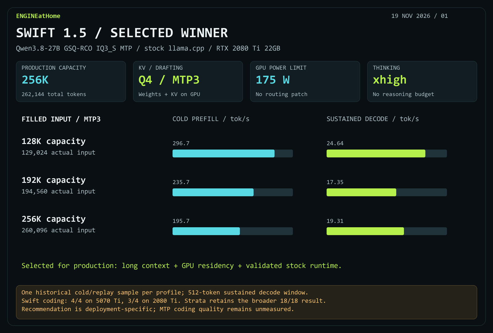
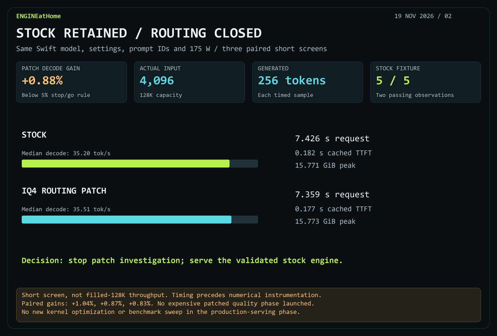
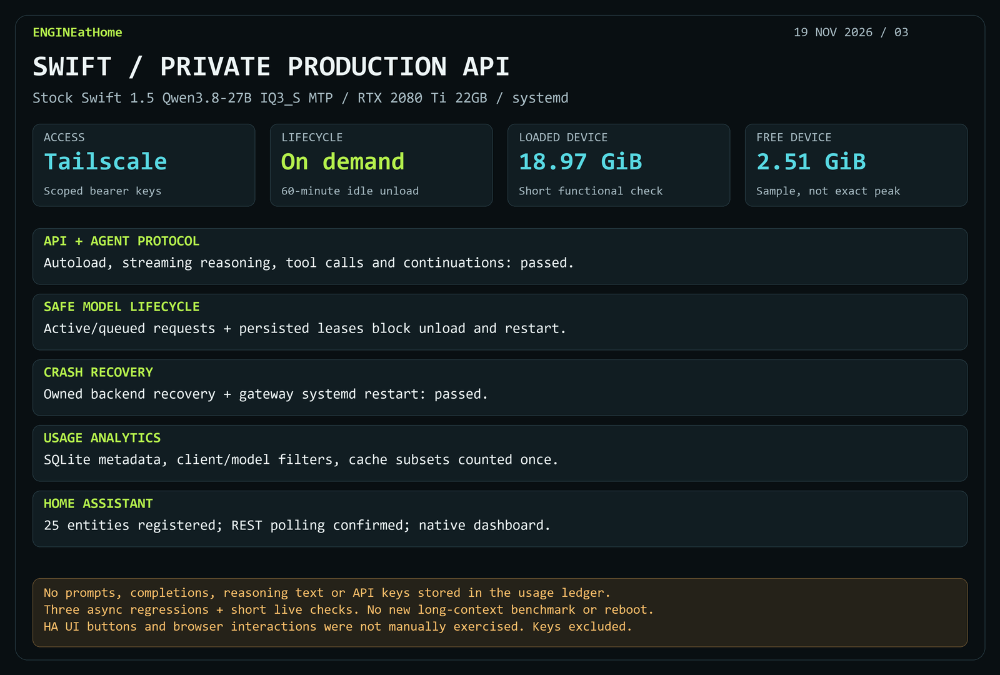

# Selected winner: stock Swift 1.5

Swift 1.5 Qwen3.8-27B GSQ-RCO IQ3_S MTP is the selected production model for this deployment. The choice combines useful context, fully GPU-resident weights and KV, measured retrieval, reasoning/tool continuations and a validated stock runtime. It is a deployment recommendation rather than proof of superiority on every coding task.



## Recommended configuration

RTX 2080 Ti 22GB; stock llama.cpp build 12519 at `98d67c8d536dc584897c4adb2510509796517222`; 262,144 total context; Q4_0 target/draft KV; MTP3; Flash Attention; batch 512/microbatch 128; full GPU weights including embeddings; 175 W. Thinking uses xhigh with no separate reasoning-token budget. Per-request total output allowances are distinct from reasoning budgets.

Checkpoint SHA256: `9aecf1cd41b2cb2f32a74e0d889e33855ebef43b26f43b43feb5720239e677e5`.

| Capacity | Actual input | Cold prefill tok/s | Sustained decode tok/s | Cold / cached TTFT | Peak sampled device VRAM |
|---|---:|---:|---:|---:|---:|
| 128K | 129,024 | 296.66 | 24.64 | 434.945 / 0.263 s | 15.77 GiB |
| 192K | 194,560 | 235.75 | 17.35 | 825.323 / 0.308 s | 17.49 GiB |
| 256K | 260,096 | 195.71 | 19.31 | 1329.068 / 0.351 s | 19.21 GiB |

These are existing filled-context MTP3 results, not new production measurements. Each profile has one cold retrieval and replay, plus a separate 512-token sustained decode window. Cold and cached three-record retrieval passed at each context. Prefix filler is disclosed in the [full MTP report](swift-filled-mtp-homelab-20261118.md); small differences do not have repeat-derived confidence intervals.

The separate headroom test accepted 131,072 input tokens in 262,144 capacity, allowed 130,816 total output tokens and stopped naturally after 30,154 generated tokens. It measured 294.72 prefill / 21.91 decode tok/s and completed two function calls across three assistant turns. See the [headroom report](swift-headroom-homelab-20261118.md) for exact retention limitations.

## Coding evidence and ranking scope

| Configuration | Strict | Held-out patch | Attempts | Task time |
|---|---:|---:|---:|---:|
| Swift 1.5, RTX 5070 Ti, 64K, MTP off | 4/4 | 4/4 | 4 | 34.80 min |
| Swift 1.5, RTX 2080 Ti, 64K, MTP off | 3/4 | 3/4 | 4 | 57.83 min |
| Guided Strata Coder, broader six-issue set | 18/18 | 18/18 | 18 | 74.0 min |

The two Swift rows share the frozen four-attempt set; the third row has different coverage and runtime/model settings. Swift's failed 2080 Ti Sphinx attempt remains a failure. MTP coding quality and an equivalent Swift 18-attempt matrix remain unmeasured. Strata remains the broader measured consistency leader; Swift is the chosen serving configuration. [Swift coding details](swift-2080ti-20261119.md#coding-quality-comparison) · [Strata evidence](strata-coder-guided18-20261111.md).

## Final optimization verdict



The final controlled short screen measured stock **35.2009** versus IQ4-routing-patched **35.5119 tok/s**, a **0.8834%** median decode increase against a predefined 5% threshold. It used 4,096 actual input tokens at 128K capacity, 256 generated tokens and three paired repeats. Median cached TTFT was 0.1815 / 0.1775 seconds, wall time 7.4262 / 7.3594 seconds and peak sampled VRAM 15.7715 / 15.7734 GiB.

Stock reproduced the frozen five-case dependency fixture. The numerical screen matched 32 greedy IDs but showed different relative log probabilities; this does not establish numerical identity. The expensive patched-quality and filled-context phases were skipped because the speed screen failed its gate. Stock was retained; no further kernel experiment was implemented. [Detailed verdict and numerical observations](swift-final-routing-2080ti-20261119.md).

## Production serving



The deployed gateway keeps an authenticated API available while the model is unloaded. It supports on-demand loading, a 60-minute idle timeout, active-request and lease protection, streamed reasoning and tool calls, systemd recovery, metadata-only SQLite accounting and native Home Assistant REST controls/sensors.

Three async regression tests and short live protocol/lifecycle checks passed. Killing the owned native process and gateway separately verified recovery and durable accounting. HA registered 25 entities and authenticated polling was observed. HA buttons/browser interactions and a physical reboot were not exercised. No long-context inference or benchmark sweep ran during this serving phase.

API keys, generated private configuration, HA secrets, live usage databases and screenshots are excluded from publication. [Setup, permissions, client examples and rollback](production-serving.md) · [Serving source](../serving/) · [Structured publication data](results/swift-serving-20261119.json).

Regenerate these three cards without inference:

```bash
python -m bench.swift_serving_cards
```
